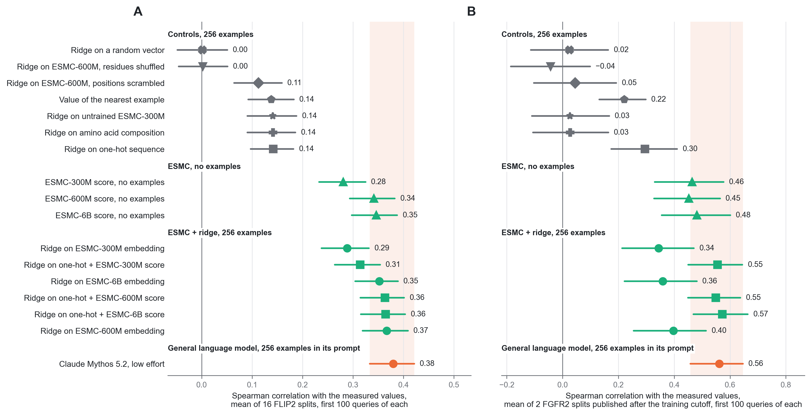

# General language models against protein language models

A **confounder-audited compilation of generalized LLM results in protein biology** paired with **controlled head-to-head
benchmarks against protein language models (pLMs)**, organized so both humans and agents can inspect what general-purpose
language models can currently do strictly where the evidence is rigorous.

- **Explore live in your browser (GitHub Pages):**
  - **[Experiment Explainer](https://lhallee.github.io/general_models_vs_plms/)** (`docs/index.html`, step-by-step interactive walkthrough of our controlled experiments)
  - **[32-Study Compilation & Confounder Explorer](https://lhallee.github.io/general_models_vs_plms/compilation.html)** (`docs/compilation.html`, filterable claims, 8-axis confounder matrix, and full study dossiers)
- **Jump straight to our controlled experiments:** [What we found](#what-we-found), [RESULTS.md](RESULTS.md), and the
  [Expanded Post-Cutoff MaveDB Suite](POSTCUTOFF_BENCHMARK.md) (`FGFR2`, `GBA1`, `ARAF`).
- **Query the structured literature & X compilation:** Read [COMPILATION.md](COMPILATION.md) / [SURVEY.md](SURVEY.md),
  or run `python -m general_models_vs_plms.catalog query --rigorous-only` (`catalog/index.json`, `catalog/claims.csv`,
  `catalog/studies.jsonl`, and per-study dossiers under `studies/`).

> **Headline across our controlled experiments (updated 2026-11-25):** On the 16 FLIP2 splits (256 labeled variants),
> Claude Mythos 5.2 in context (`0.380`) ties standard final-layer mean-pooled ESMC ridge (`0.367`) and ProGen2
> preference tuning (`0.360`–`0.378`), **but better ESMC featurization breaks the tie decisively in favor of pure frozen
> pLMs**: a single frozen ESMC-600M model stacked with canonical depth layer 27 (or penultimate layer 35) plus the
> released ESMFold2 width-256 structural stream reaches **`0.443`–`0.444`** (`+0.063`–`+0.064` strictly above Mythos 5.2),
> and pure frozen ESMC-600M + ESMC-6B reaches **`0.457`** (`+0.077` `[+0.028, +0.124]` above Mythos 5.2), while averaging
> Claude Mythos 5.2 with mutation-site ESMC-600M reaches **`0.467`**. Across our post-June-2026 MaveDB suites (all 300
> queries), **canonical intermediate depth layers (23/27/60) + the ESMFold2 structural stream** lift `GBA1`/`ARAF` (6
> splits) to **`0.586`** (single 6B **`0.578`**, `+0.028` strictly above final-layer stacked 6B and `+0.118` over prior
> baselines) and `FGFR2` (2 splits) to **`0.491`** (vs `0.449` prior ridge / `0.425` Claude Fable 5.2). Independently,
> **ESMC-6B's penultimate layer (`-2`, L79)** strictly beats final-layer pooled features on every benchmark (`+0.033`
> FLIP2 q300, `+0.077` FGFR2 q300, `+0.037` `GBA1`/`ARAF` q300).

Every table and figure from our first three experiments is in [RESULTS.md](RESULTS.md), the live interactive walkthrough
is at [lhallee.github.io/general_models_vs_plms](https://lhallee.github.io/general_models_vs_plms/) (`docs/index.html`),
the live literature audit is at
[lhallee.github.io/general_models_vs_plms/compilation.html](https://lhallee.github.io/general_models_vs_plms/compilation.html)
(`docs/compilation.html`), and reproduction commands are in [REPRODUCE.md](REPRODUCE.md).

## What we found

Claude Mythos 5.2 was shown 256 labeled variants of a protein as plain text, with the protein unnamed, and was asked
to rank 100 held-out variants. Ridge regression was fit on the same 256 rows with features from ESM-2 650M and from
ESMC at three sizes, the generative protein language model ProGen2-small was tuned on them, and every method was
scored on the same queries. Each number below is a mean Spearman correlation with the measured values, and each
interval is a 95% interval from 2,000 paired bootstrap draws of the queries.

*Mean Spearman with 95% intervals, on the first 100 queries of each split. **A**, the 16 FLIP2 splits. **B**, the 2
FGFR2 splits, published after the model's training data end. Gray rows are controls, green rows are ESMC at three
sizes, and orange is Claude Mythos 5.2, whose interval is the shaded band. Triangles use no examples, and circles and
squares are ridges fit on the same 256 rows the model reads.*

| 256 examples unless said, first 100 queries of each split | FLIP2, 16 splits | FGFR2 after the cutoff, 2 splits |
|---|---|---|
| Best control without a trained protein model (ridge on one-hot sequence) | 0.142 (0.097 to 0.182) | 0.295 (0.175 to 0.410) |
| ProGen2-small score with no examples | 0.239 (0.188 to 0.286) | 0.412 (0.278 to 0.521) |
| ProGen2-small tuned on the 256 rows with a preference loss (DPO), recipe set in advance | 0.263 (0.214 to 0.306) | 0.314 (0.187 to 0.429) |
| ProGen2-small tuned, one setting for 20 epochs, picked after the first scores | 0.339 (0.290 to 0.379) | 0.342 (0.209 to 0.463) |
| Best ESMC score with no examples (ESMC-6B) | 0.346 (0.298 to 0.388) | 0.481 (0.355 to 0.601) |
| ProGen2-base tuned, the same one setting for 20 epochs | 0.360 (0.314 to 0.401) | 0.379 (0.241 to 0.499) |
| Best ridge on mean-pooled ESMC features | 0.367 (0.319 to 0.409) | 0.572 (0.469 to 0.663) |
| Claude Mythos 5.2 reading the 256 rows in its prompt | 0.380 (0.333 to 0.421) | 0.561 (0.458 to 0.646) |
| Frozen ESMC-600M mutation-site local pooling + zero-shot ridge (single 600M pLM) | **0.429** (0.382 to 0.469) | 0.431 (0.305 to 0.543) |
| **Single frozen ESMC-600M depth (L27) or penultimate (L35) + ESMFold2 structural stream** | **0.443 / 0.444** (0.395 to 0.484) | **0.505** (q300: **0.469**) |
| **Pure frozen pLM: ESMC-600M + ESMC-6B depth (L27/L60) + structural stream stacked** | **0.446** (0.400 to 0.484) | **0.529** (q300: **0.487**; all-3: **0.491**) |
| **Pure frozen pLM: ESMC-600M + ESMC-6B mutation-site + zero-shot rank average** | **0.457** (0.410 to 0.496) | 0.496 (stacked, q300: 0.453) |
| Average of Claude Mythos 5.2 and old mean-pooled ESMC ridge | 0.443 (0.399 to 0.482) | 0.611 (0.516 to 0.692) |
| **Average of Claude Mythos 5.2 and mutation-site ESMC-600M ridge** | **0.467** (0.422 to 0.505) | 0.605 (Mythos + depth+struct 6B) |

The best ridge is the one on the ESMC-600M embedding for FLIP2 and the one on one-hot features with the ESMC-6B score
for FGFR2, and the average in the last row pairs the model with that same ridge.

### In-context learning ties the best ridge on ESMC features

Over the 16 FLIP2 splits the model reaches 0.380 and the best ridge reaches 0.367, so the paired difference is +0.013
with an interval of -0.038 to +0.065 that includes zero. The rule was fixed before any model was asked, and it counts
in-context learning as better only if that interval lies above zero. The ridge is a strong opponent, because it is the
best of several and is chosen on the queries it is scored on, while no control without a trained protein model scores
above 0.14.

The tie is an average of large wins and large losses, since the model is ahead on 3 splits, behind on 3, and undecided
on 10. It falls furthest behind where every test value lies above the range of its examples, and it leads most on the
absorption maxima of rhodopsins, which it predicts at 0.658 with no examples at all. With that dataset left out, a
check added after the results were seen, the model scores 0.36 and the ridge 0.38.

### The tie holds on data published after the model's training

FLIP2 was public before the model's training data end, so a good score there could come from memory of the benchmark.
The same comparison was therefore repeated on an FGFR2 drug resistance screen that MaveDB published on 20 November
2026, after that date, where the model scores 0.561 and the best ridge 0.572.

### A generative protein language model tuned on the same rows reaches the level of both at its best recipe, and passes neither

A ridge never changes its protein model, so a third experiment tried the recipe that changes every weight. For each
split, ProGen2-small was tuned on the 256 rows with a preference loss (Direct Preference Optimization, DPO), which
teaches the model to give a variant with a higher measured value a higher likelihood, and the tuned model then ranked
the same 100 queries. Under the recipe set before the run, with the learning rate, the weight of the loss, and the
epoch chosen on 51 of the 256 rows, it reaches 0.263 on FLIP2, which is -0.117 (-0.163 to -0.071) from Claude Mythos
5.2 and -0.104 (-0.159 to -0.050) from the best ridge, and 0.314 on FGFR2, where it is behind both as well.

That recipe understates the method by about 0.07. Runs added after those scores were seen show that the 51 rows
choose a worse setting and stopping point than one setting run to a fixed length, so that setting (learning rate
0.00001, weight 2, 20 epochs, nothing chosen) was scored on queries 101 to 300 of each split, which had no part in
picking it. There ProGen2-small scores 0.324, +0.075 (+0.049 to +0.102) above the recipe set in advance and -0.026
(-0.063 to +0.013) from the best ridge on those queries, and ProGen2-base, a model five times larger, scores 0.339,
-0.012 (-0.048 to +0.025) from that ridge. On the first 100 queries ProGen2-base scores 0.360, -0.006 (-0.061 to
+0.043) from the best ridge and -0.020 (-0.067 to +0.026) from Claude Mythos 5.2. Every one of those intervals
includes zero and none lies above it, so at its best recipe preference tuning is level with the ridge and with the
general model on FLIP2 and beats neither. On the first 100 FGFR2 queries it stays behind both, at 0.379, -0.183
(-0.334 to -0.037) from Claude Mythos 5.2.

*Mean Spearman with 95% intervals, on the first 100 queries of each split. **A**, the 16 FLIP2 splits. **B**, the 2
FGFR2 splits. Olive rows are ProGen2-small: its score with no examples (triangle), a ridge on its hidden states
(circle), and the model tuned on the 256 rows with a Bradley-Terry loss (hollow hexagon) and with the ranked preference
loss (filled hexagon). The gray row is the control, the same tuning on shuffled values. Green rows are the best
ridges on ESMC features, and orange is Claude Mythos 5.2, whose interval is the shaded band.*

*Mean Spearman over the 16 FLIP2 splits after each epoch of the one setting, for ProGen2-small. **A**, on the 51 rows
held out from the examples. **B**, on every query of each split. The triangle is the released model, the hexagons
are the two epochs read with nothing chosen, the green line and band are the best ridge on those queries, and the
dotted line is the score under the recipe set in advance.*

The held-out rows mislead because they are drawn like the examples and FLIP2's test queries are not. On those rows
the tuning does what it is built to do, lifting the mean Spearman from 0.245 to 0.628 at the chosen checkpoint, and
their score keeps rising with more epochs while the score on the test queries is level from about epoch 15. About
half of the 0.07 comes from five splits on which the 51 rows chose another setting, and half from an earlier stop.
The control explains the level of the first recipe: tuning on shuffled values lowers the released model's score by
0.109, and tuning on the measured values scores 0.133 above that control.

Four more changes were tried on ProGen2-small with the checkpoint still chosen on held-out rows. A learning rate ten
times lower (0.205) and a low-rank update on frozen weights (0.200) score below the first recipe. Tuning on every
labeled row of a split, up to 2,048, scores 0.344 on all queries, 0.088 above tuning on 256, and stays -0.065
(-0.093 to -0.037) from the best ridge fit on the same rows. The ranks of the tuned model averaged with those of the
best ridge or of Claude Mythos 5.2 tie the other method alone. On rows with no shift a ridge on the ESMC-600M
embedding still leads (0.637 against 0.52 for the tuned model at a fixed recipe and 0.572 for a ridge on
ProGen2-small's own hidden states), so part of what remains is the protein model and not the way it is fit. The
fixed recipe was picked with the measured values of the first 100 queries of these splits, it ran under one batch
order, and no ESMC model was tuned.

The preference loss by itself also leaves the tuned model unfit as a model of sequences. It reads only how the rows
of a batch differ, and under the fixed recipe the mean log-likelihood per residue that ProGen2-small gives the test
queries falls from -2.12 as released to -7.71 after 20 epochs, on every FLIP2 split. Adding the negative
log-likelihood of each pair's preferred row to the loss, as Iterative Reasoning Preference Optimization does, slows
that fall at the lightest of three weights and stops it at the other two. It does not change the comparison. At that
method's own weight of 1, the run named in advance as the primary one, the ranking does not improve: 0.295 on queries
101 to 300, -0.030 (-0.063 to +0.005) from the recipe without the term. At a tenth and a hundredth of that weight it
scores 0.348 and 0.344, +0.024 (-0.002 to +0.051) and +0.020 (+0.001 to +0.039), which is level with the best ridge
on those queries (0.351) and not above it. Three weights were read under one batch order, so the gain of about 0.02
is a lead and not a finding.

### The model learns from its examples and also uses what it knows about the protein

Three changes to the prompt, tried on one split per dataset where the plain prompt scores 0.496, separate what the
model takes from the rows from what it brings with it. Reversing the measured values reverses its ranking, to -0.235,
which shows that the ranking follows the rows. Renaming the residues with a cipher, so that the protein cannot be
recognized, lowers the score to 0.278, a little above a ridge on one-hot features at 0.209, so about half of the score
depends on knowing the protein. With no examples at all the model scores 0.391, where the best score a protein
language model gives without examples, from ESMC-6B, is 0.318.

### It recognizes the benchmark and does not recite its values

Shown a parent sequence and 30 unlabeled rows, the model named the protein, the measurement, and the source study of
all seven FLIP2 datasets, and for FGFR2 it named the kinase domain and gave no source. Recognition is not recall of
the measurements, however, because when it was asked to write the published values of the four datasets with
continuous values it matched 0 of 400 exactly.

### It can write many of these proteins out, and that does not explain its accuracy

A second experiment hid 15%, 50%, and 85% of the residues of 48 rhodopsins and asked each model to restore them.
Claude Mythos 5.2 restored 91%, 76%, and 57%, while ESMC-6B restored 59%, 54%, and 13% from the same masks and no
model rose above the 11% of a guess on shuffled copies. The model also returned the FGFR2 kinase domain whole with half of
it hidden, so the FGFR2 screen is new to it and the protein is not.

How much of a rhodopsin the model can restore does not predict its error on that rhodopsin's absorption maximum, with
a Spearman of -0.15 (-0.41 to +0.13) across the 48. For the protein language models the matching measure is the
pseudo-log-likelihood of a sequence, and it tracks the error of the ridge on the embedding for ESMC-600M alone among
the four models (-0.50, -0.64 to -0.33), so it is no general guide to where such a ridge fails.

### Averaging the two rankings beats both

The model and the ridge err on different variants, which makes the plain average of their rankings, with equal weights
and no tuning, the best predictor measured here at 0.443 on FLIP2 and 0.611 on FGFR2.

### Mutation-site ESMC pooling breaks the FLIP2 tie, and multi-family post-cutoff assays generalize beyond FGFR2

A fourth experiment (`2026-11-25_esmc_adaptation_and_postcutoff`) tested why the initial ESMC ridges tied Claude Mythos
5.2 on FLIP2 and expanded our post-June-2026 MaveDB benchmark from one kinase domain (`FGFR2`) to **three unrelated human
protein families** (`FGFR2`, `GBA1` lysosomal hydrolase, and `ARAF` kinase activity & abundance; max pairwise ungapped
identity <= 12.5% and <= 16.7% to FLIP2; pre-cutoff `PRKN` audited and excluded):

- **Pure frozen pLMs strictly beat Claude Mythos 5.2 on FLIP2:** Global mean pooling dilutes 1 to 3 mutated sites across
  320 to 606 unchanged residues. Extracting mutated-site hidden states (`h_mut[M]` and `h_mut[M] - h_wt[M]`) plus
  masked-marginal zero-shot scores lifts single-model frozen ESMC-600M from `0.367` to **`0.429`** (`+0.062` over
  `ridge_esmc_600m`), and an equal-weight rank average of frozen ESMC-600M and ESMC-6B reaches **`0.457`**
  (`[0.410, 0.496]`), **strictly beating Claude Mythos 5.2 (`0.380`) by +0.077 (`[+0.028, +0.124]`)** with zero LLM calls
  and zero weight fine-tuning. Shuffled-label negative controls score `+0.009` to `+0.011`. Averaging Claude Mythos 5.2
  with mutation-site ESMC-600M raises the hybrid ceiling from `0.443` to **`0.467`** (`+0.087` over Mythos alone).
- **Expanded 6-split post-cutoff MaveDB suite (`GBA1`, `ARAF` activity, `ARAF` abundance, all 300 queries):** A 5-fold
  out-of-fold stacked multi-view ridge on frozen ESMC-6B (`mean_emb` + `mutsite` + `one_hot` + `zero_shot`, fit strictly
  on the 256 context rows) reaches **`0.549`** (`[0.511, 0.582]`), strictly beating the prior FGFR2 recipe
  (`ridge_onehot_plus_esmc_6b`, `0.461`) by **+0.088 (`[+0.051, +0.124]`)**, reaching `0.728` on `GBA1` and `0.669`
  (ESMC-600M) on `ARAF` activity while separating `ARAF` cellular abundance (`0.363`).
- **ConFit-style KL-anchored LoRA preference tuning of ESMC:** Rank-8 LoRA adapters initialized at exact zero-shot parity
  (verified to 0.0002) with KL=0.1 regularization prevent ProGen2's likelihood collapse and gain **+0.053 to +0.065** over
  zero-shot on single-site post-cutoff DMS (`confit_esmc_300m` **`0.516`**, `confit_esmc_600m` **`0.512`**), beating old
  ridges there; under FLIP2's heavier extrapolation shift (`0.310`–`0.334`), frozen mutation-site and stacked ESMC ridges
  (`0.414`–`0.457`) remain substantially stronger.
- **Zero-spend open-weight general LLM pilot (`Qwen/Qwen3-14B`, BF16, direct mode):** Across `amylase/by_mutation` and
  post-cutoff `fgfr2/random`, `Qwen3-14B` shows zero biological prior (`k0_described` `-0.121` and `+0.053`), achieves
  pure tabular in-context regression (`k256` `+0.403` and `+0.404`, reversing to `-0.337` / `-0.372` under `k256_flipped`),
  and is invariant to residue enciphering on post-cutoff `fgfr2/random` (`+0.404` plain vs `+0.406` cipher), cleanly
  isolating the ~+0.25–0.30 protein prior that frontier Claude Mythos 5.2 adds on top of tabular ICL.

### Intermediate ESMC layers (23/27/60) + structural stream and penultimate layer (-2) ablation

A fifth experiment (`2026-11-25_esmc_layers_and_structure`) re-extracted all three ESMC scales (`300M`, `600M`, `6B`)
across all 24 splits (16 FLIP2, 2 post-cutoff `FGFR2`, 6 post-cutoff `GBA1`/`ARAF`) using exact canonical FastPLMs taps
(depth layers `23`/`27`/`60`, penultimate layer `-2` at `29`/`35`/`79`, final layer `-1`, and the released ESMFold2
width-256 structural stream in one BF16 pass per batch, fixing two-chain `pdz3` concatenation):

| ESMC representation (256 context rows) | FLIP2 q100 (16) | FLIP2 q300 (16) | FGFR2 q100 (2) | FGFR2 q300 (2) | GBA1+ARAF q300 (6) |
|---|---:|---:|---:|---:|---:|
| Prior final-layer mean-pool (`ridge_esmc_600m` / `esmc_6b`) | 0.367 / 0.352 | 0.355 / 0.344 | 0.397 / 0.359 | 0.385 / 0.338 | 0.489 / 0.500 |
| **ESMC-6B penultimate L79 pooled (`penult_mv`, no struct/ZS)** | **0.379** | **0.383** | **0.513** | **0.405** | **0.530** |
| **ESMFold2 256-d structural stream alone (`struct_mv`, 600M / 6B)** | **0.381** / 0.336 | 0.363 / 0.351 | 0.435 / 0.414 | 0.414 / 0.395 | 0.491 / **0.533** |
| Final-layer stacked (`600M` / `6B`) | 0.422 / 0.405 | 0.407 / 0.389 | 0.442 / 0.483 | 0.423 / 0.427 | 0.538 / 0.550 |
| **Penultimate (-2) stacked (`600M` L35 / `6B` L79, no struct)** | 0.410 / 0.411 | 0.399 / 0.406 | 0.470 / **0.543** | 0.432 / 0.447 | 0.552 / 0.556 |
| **Depth (L27/L60) + structural stream stacked (`600M` / `6B`)** | **0.443** / 0.396 | **0.425** / 0.401 | **0.505** / 0.476 | **0.469** / 0.452 | **0.560** / **0.578** |
| **Penultimate + structural stream stacked (`600M` / `6B`)** | **0.444** / 0.404 | **0.426** / 0.403 | 0.472 / 0.524 | 0.454 / 0.450 | 0.557 / 0.566 |
| **Ensemble `600M+6B`: Depth (L27/L60) + structural stacked** | **0.446** | **0.435** | **0.529** | **0.487** (all-3: **0.491**) | **0.586** |

- **Intermediate depth layers (`23`/`27`/`60`) + ESMFold2 structural stream set new post-cutoff and single-model FLIP2 records:**
  Depth hidden states alone drop sharply on variant regression (`0.212`–`0.359`), while the 256-d structural stream alone
  strictly beats 2,560-d final-layer ESMC-6B on `GBA1`/`ARAF` (`0.533` vs `0.493`, `+0.040` `[+0.013, +0.067]`) and beats
  final-layer ESMC-600M on every panel. Combining depth + structural stream lifts `GBA1`/`ARAF` to **`0.586`** (`600M+6B`;
  single 6B **`0.578`**, `+0.028` `[+0.004, +0.052]` strictly above final-layer stacked 6B), lifts `FGFR2` q300 to
  **`0.487`**–**`0.491`** (single 600M `0.469`, `+0.046` `[+0.004, +0.087]` strictly above final-layer stacked), and lifts
  a **single 600M model** on FLIP2 to **`0.443`** (`+0.063` `[+0.020, +0.104]` strictly above Claude Mythos 5.2 `0.380`),
  driven by large gains on structural stability transfer (`hydro/to_P06241`: `0.345 -> 0.696`, `hydro/to_P01053`:
  `0.212 -> 0.588`), `araf_activity/by_position` (`0.563 -> 0.662`), and `araf_abundance/by_position` (`0.327 -> 0.395`).
- **Penultimate layer (`-2`) independently beats final layer everywhere on ESMC-6B and on all post-cutoff suites:**
  With zero structural features and zero zero-shot scores, pooled `penult_mv` from ESMC-6B (`L79`) strictly beats final-layer
  pooled ESMC-6B on FLIP2 q300 (`0.383` vs `0.350`, `+0.033` `[+0.013, +0.054]`), FGFR2 q300 (`0.405` vs `0.328`, `+0.077`
  `[+0.018, +0.135]`), and `GBA1`/`ARAF` q300 (`0.530` vs `0.493`, `+0.037` `[+0.009, +0.063]`). Combining penultimate +
  structural stream reaches `0.444` (FLIP2 q100 single 600M) and `0.566` (`GBA1`/`ARAF` single 6B). Shuffled-label controls
  stay near zero (`-0.020` to `+0.041` on FLIP2 q100; `-0.075` to `+0.016` on `GBA1`/`ARAF`).

### Through the public API, Claude Fable 5.2 also ties its best ridge

A separate experiment asked four Claude models through the public API and scored all 300 queries of each split, so its
numbers are compared only with baselines scored on those queries and are never set beside the ones above. Claude Fable
5.2 scores 0.365 where the best ridge scores 0.355, a difference of +0.009 (-0.015 to +0.036). Claude Opus 5 (0.264),
Claude Opus 5.5 (0.252), and Claude Haiku 5.5 (0.176) are below that ridge, and Claude Opus 5.5 refused 68 of its 265
prompts at low effort.

## What the field has found (32-study confounder-audited compilation)

As of 25 November 2026, we maintain a structured, machine-queryable compilation of **32 studies** across peer-reviewed
papers, arXiv/bioRxiv preprints, technical reports, primary GitHub benchmarks, X threads, and our own experiments
(**26 audited from full text / primary data** across 8 explicit confounder and leakage axes; **6 queued unread** and
strictly excluded from critiques; **62 indexed claims: 34 supported/controlled, 15 suggestive/confounded, 7 unverified or
likely leaked**).

- **Live interactive web explorer (GitHub Pages):**
  [lhallee.github.io/general_models_vs_plms/compilation.html](https://lhallee.github.io/general_models_vs_plms/compilation.html)
  (offline copy: [docs/compilation.html](docs/compilation.html); filter by task, evaluation regime, evidence strength,
  source tier, model, and clickable 8-axis confounder matrix).
- **Full compiled report & per-study dossiers:** [COMPILATION.md](COMPILATION.md), [SURVEY.md](SURVEY.md), and
  `studies/<study_id>.md`.
- **Agent / script interface:** `catalog/index.json`, `catalog/claims.csv`, `catalog/studies.jsonl`, or
  `python -m general_models_vs_plms.catalog query --rigorous-only --task variant_effect_few_shot --json`.

Strictly where the evidence is controlled against temporal cutoffs, homology leakage, preprocessing artifacts, and
downstream oracle filtering, general language models:
1. Show real sequence memorization / familiarity in Claude 5.2 models (`+45.1` pp on TrEMBL DUFs, `+22.1` pp post-cutoff
   in Tu & Chen 2026; 76% 50%-mask rhodopsin restoration here), largely absent from GPT/Gemini/open LLMs, though
   memorization does not explain fitness accuracy and decays sharply on post-cutoff / divergent sites (Kosinski 2026).
2. Fall far behind specialists without tools on monomer folding (<0.50 TM vs ESMFold2 0.89), inverse folding (0.43–0.46
   scTM vs ProteinMPNN 0.88–0.94), de novo design (0%), closed-loop binder design (0% vs BoltzGen 8.33%), blind Post-NK
   CAFA-6 function prediction (-0.224 drop, below NetGO 4.0), and unseen interface alanine scans (Guloglu 2026; OpenAI
   2026; Seo et al. 2026).
3. Match standard single-sequence zero-shot and mean-pooled pLMs on variant ranking, **trail properly adapted frozen
   mutation-site / stacked ESMC ridges on FLIP2 (`0.380` vs `0.457`)**, and deliver their clearest practical gains when
   **combined with specialized protein models or tools** (either rank-averaged with ESMC at `0.467` here, or orchestrating
   structure/design tools and multi-model oracle filters in Anthropic Claude Science 2026 and OpenAI 2026).

| Question | General language models | Protein-specific models | Source |
|---|---|---|---|
| Do they hold natural protein sequences? | Claude Fable 5.2 predicts the next residue of proteins from families of unknown function at 54% against 9% on shuffled copies, a gap of 45 points. GPT, Gemini, and seven open-weight models are near zero | Autoregressive protein language models show smaller gaps on the same probe, 32.5 points for ProGen3-3B and 27.7 for ProtGPT3-10B | Tu and Chen, November 2026 |
| | Claude Mythos 5.2 restores 76% of a rhodopsin with half of its residues hidden | ESMC-6B restores 54% from the same masks | This repository |
| Do they know structure? | Contact maps from Claude Fable 5.2 reach a long-range precision of 0.18 to 0.49 on well-studied proteins and 0.04 to 0.33 on proteins with no relative in the PDB | No comparison in the source | Kosinski, November 2026 |
| Can they rank variants with no examples? | Claude Opus 5 at Spearman 0.406 and GPT 5.6 Sol at 0.402 on 276 tasks | ESM2-650M at 0.411, and the specialist VenusREM at 0.523 | Arora and colleagues, July 2026 |
| | DeepSeek-Reasoner alone at 0.159 on ProteinGym, and 0.551 as part of an agent system with tools | ESM2-650M at 0.414 and VenusREM at 0.518 | Tan and colleagues, January 2026 |
| | Claude Mythos 5.2 at 0.391 on 7 FLIP2 splits | ESMC-6B at 0.318 | This repository |
| Can they learn from labeled examples in the prompt? | Competitive with XGBoost on four peptide classification tasks and not significantly above it | No protein language model baseline in the abstract | Zhao and colleagues, November 2026 |
| | Claude Mythos 5.2 at 0.380 on FLIP2 with 256 examples | Ridge on the ESMC-600M embedding at 0.367 | This repository |
| Can they answer questions about proteins? | GPT-5 at 60.65% mean accuracy on twelve tasks | The best protein-specific chat model at 31.83% | Rong and colleagues, December 2025 |

Across these sources and the results here, memory of natural sequences is real in the newest Claude models and is
absent from the other general models that were probed, yet in our test it does not predict how well a property is
predicted. On ranking variants, a general model sits level with a single-sequence protein language
model whether it is given no examples or 256 of them, and below the specialist predictors. The gains reported so far
come from combination, either as a general model that is given the outputs of specialist tools or as its ranking
averaged with a ridge on protein language model features.

Among the sources surveyed, none gives a general model labeled protein variants in its prompt and compares it with a
ridge on protein language model features fit on the same examples, which is the comparison made here.

## How the comparison was made

| Piece | What it is |
|---|---|
| Data | The 16 splits of the 7 FLIP2 datasets, and 2 splits of an FGFR2 drug resistance screen from MaveDB that was published after the models' training data end |
| Task | 256 labeled rows drawn from a split's training part and up to 300 test queries, 100 to a prompt, as plain text with one variant and its value per line and the protein unnamed |
| Baselines | Ridge regression on one-hot features, on the mean-pooled embedding of ESM-2 650M, ESMC-300M, ESMC-600M, and ESMC-6B, and on one-hot features with a model's zero-shot score, all fit on the same 256 rows, and the zero-shot scores alone |
| Controls for the ridge | A random vector, amino acid composition, an untrained ESMC-300M, and trained ESMC given shuffled residues or scrambled positions |
| Controls for the language model | Enciphered residues, reversed values, shuffled values, no examples, and the protein named |
| Tuned protein language model | ProGen2-small, 151 million weights, with every weight tuned on 205 of the 256 rows by a ranked preference loss (Direct Preference Optimization, DPO) or a Bradley-Terry loss, and the learning rate, the weight of the loss, and the epoch chosen on the other 51 rows (73 and 51 on the one split with 124 rows) |
| Controls for the tuning | The same model with no examples, a ridge on its hidden states, the same tuning on shuffled values, and two more batch orders |
| Other scales of the tuning | One setting run for 20 and 40 epochs with nothing chosen, on ProGen2-small and on ProGen2-base (764 million weights), scored on every query; a learning rate ten times lower; a low-rank update; every labeled row of a split; the one setting with a likelihood term added to the loss at three weights; and every baseline fit on the 205 tuning rows and scored on the 51 held-out rows |
| Score | Spearman on each split, averaged over splits, with every comparison made on the same queries for both sides |

Claude Mythos 5.2 was asked through fresh subagents of a coding agent, one per prompt, at the effort level chosen on
validation rows, and each subagent's transcript was checked for the model that answered and for any tool use beyond
reading its prompt and writing its answer.

## Limits

Each Claude Mythos 5.2 score rests on one prompt of 100 queries per split, one draw of the 256 rows, and one answer per
prompt, so the intervals cover the draw of queries and not the spread between two answers to one prompt. The subagent
route also puts a coding agent's instructions in front of every prompt, and the prompt controls ran on one split per
dataset. The first 100 FGFR2 queries are easier than the rest for every method, with the best ridge at 0.45 on all 300,
which makes 0.56 a score on those queries and not the level of the dataset. The test of sequence memory covers one
dataset, and its 48 sequences detect only a correlation of about 0.4 or more. The tuned protein language models are
two generative models of one family. The recipe set in advance has three batch orders and a control, and the fixed
recipe that reaches the ridge has one batch order, no control, and a setting picked with the measured values of the
first 100 test queries, so its scores on those queries are optimistic and its scores on queries 101 to 300 are the
ones to read. The likelihood term was read at three weights on ProGen2-small alone, under one batch order. The result
does not say what a tuned ESMC would score.

## Repository

| Path | What it holds |
|---|---|
| [docs/compilation.html](https://lhallee.github.io/general_models_vs_plms/compilation.html) | Live interactive confounder-audited compilation explorer (GitHub Pages & offline HTML) |
| [docs/index.html](https://lhallee.github.io/general_models_vs_plms/) | Live interactive explainer for our controlled experiments (GitHub Pages & offline HTML) |
| [COMPILATION.md](COMPILATION.md) / [SURVEY.md](SURVEY.md) | Full 32-study confounder-audited report and 8-axis audit matrix |
| [POSTCUTOFF_BENCHMARK.md](POSTCUTOFF_BENCHMARK.md) | Homology-audited post-June-2026 MaveDB suite (`FGFR2`, `GBA1`, `ARAF`) and zero-spend model horizon |
| `catalog/`, `studies/` | Machine-queryable JSON/JSONL/CSV study & claim catalog and 32 per-study dossiers |
| [RESULTS.md](RESULTS.md) | Every table and figure from our FLIP2, sequence-knowledge, and ProGen2 experiments |
| [REPRODUCE.md](REPRODUCE.md) | The commands for the tables, the figures, and the experiments |
| `report/figures/`, `report/tables/` | The figures, and the summary tables they are drawn from |
| [prompts/](prompts/README.md) | Every prompt Claude Mythos 5.2 was asked, as the file it read, with its answer |
| `general_models_vs_plms/`, `scripts/`, `tests/` | The package (including `catalog.py`, `postcutoff_suite.py`, `esmc_adaptation.py`, `esmc_layers.py`, `open_llm_eval.py`) and test suite |
| `Dockerfile`, `box.sh` | The image and the entrypoint the protein language models ran through |

## Sources

FLIP2 is the benchmark of Didi, Alamdari, Lu, Wittmann, Johnston, Amini, Madani, Czeneszew, Dallago, and Yang
([bioRxiv, February 2026](https://doi.org/10.64898/2026.02.23.707496)), and the FGFR2 screen is MaveDB score set
`urn:mavedb:00001329-a-3` by Annika Maria Metzner with Sven Diederichs. The ridge on one-hot features with a zero-shot
score follows Hsu, Nisonoff, Fannjiang, and Listgarten (Nature Biotechnology, 2022). ProGen2 is the model of Nijkamp,
Ruffolo, Weinstein, Naik, and Madani (Cell Systems, 2023), the ranked preference loss is that of Widatalla and
colleagues as Yang and colleagues applied it to ProGen2, and the Bradley-Terry loss is that of Hawkins-Hooker and
colleagues. The likelihood term is that of Pang and colleagues (Iterative Reasoning Preference Optimization, NeurIPS
2024, [arXiv 2404.19733](https://arxiv.org/abs/2404.19733)). Diego del Alamo proposed the comparison of in-context
learning with ridge regression on FLIP2, and the comparison with preference tuning of ProGen2. Full references are in
[SURVEY.md](SURVEY.md).
