# General language models against protein language models

Does a general-purpose language model that reads labeled protein variants in its prompt rank held-out variants better
than ridge regression on protein language model features? Diego del Alamo asked for this comparison on the
[FLIP2](https://flip.protein.properties/) benchmark on 21 November 2026, in a
[thread](https://x.com/sacdallago/status/2124189348434444295) with Christian Dallago, and raised that FLIP2 might be in
the models' training data. What others have reported on general language models and protein sequences, with dates
and authors, is in [SURVEY.md](SURVEY.md).

**It ties, and it does not outperform.** Shown 256 labeled variants, Claude Mythos 5.2 reaches a mean Spearman of 0.380
over the 16 FLIP2 splits, and the best ridge on ESMC features reaches 0.367 on the same queries. The paired difference
is +0.013 with a 95% interval of -0.038 to +0.065. The tie holds on an FGFR2 screen published after the model's
training data end (0.561 against 0.572). Every control without a trained protein model scores 0.14 or less on FLIP2.


*Mean Spearman with 95% intervals, on the first 100 queries of each split. **A**, the 16 FLIP2 splits. **B**, the 2
FGFR2 splits, published after the model's training data end. Gray rows are controls, green rows are ESMC at three
sizes, and orange is Claude Mythos 5.2, whose interval is the shaded band. Triangles use no examples, and circles and
squares are ridges fit on the same 256 rows the model reads.*

| 256 examples unless said, first 100 queries of each split | FLIP2, 16 splits | FGFR2, 2 splits |
|---|---|---|
| **Controls** | | |
| Ridge on a random vector | 0.001 (-0.048 to 0.051) | 0.025 (-0.114 to 0.164) |
| Ridge on ESMC-600M, residues shuffled | 0.002 (-0.045 to 0.051) | -0.043 (-0.185 to 0.099) |
| Ridge on ESMC-600M, positions scrambled | 0.113 (0.064 to 0.159) | 0.045 (-0.103 to 0.192) |
| Value of the nearest example | 0.138 (0.092 to 0.183) | 0.221 (0.131 to 0.298) |
| Ridge on untrained ESMC-300M | 0.141 (0.091 to 0.188) | 0.026 (-0.110 to 0.167) |
| Ridge on amino acid composition | 0.141 (0.091 to 0.186) | 0.027 (-0.106 to 0.164) |
| Ridge on one-hot sequence | 0.142 (0.097 to 0.182) | 0.295 (0.175 to 0.410) |
| **ESMC, no examples** | | |
| ESMC-300M score | 0.281 (0.233 to 0.325) | 0.464 (0.330 to 0.577) |
| ESMC-600M score | 0.341 (0.294 to 0.383) | 0.452 (0.328 to 0.564) |
| ESMC-6B score | 0.346 (0.298 to 0.388) | 0.481 (0.355 to 0.601) |
| **ESMC + ridge** | | |
| Ridge on ESMC-300M embedding | 0.288 (0.238 to 0.332) | 0.344 (0.213 to 0.471) |
| Ridge on one-hot + ESMC-300M score | 0.314 (0.264 to 0.354) | 0.555 (0.450 to 0.644) |
| Ridge on ESMC-6B embedding | 0.352 (0.304 to 0.389) | 0.359 (0.222 to 0.481) |
| Ridge on one-hot + ESMC-600M score | 0.364 (0.315 to 0.402) | 0.549 (0.450 to 0.637) |
| Ridge on one-hot + ESMC-6B score | 0.365 (0.315 to 0.404) | 0.572 (0.469 to 0.663) |
| Ridge on ESMC-600M embedding | 0.367 (0.319 to 0.409) | 0.397 (0.255 to 0.514) |
| **General language model** | | |
| Claude Mythos 5.2, 256 examples in its prompt | 0.380 (0.333 to 0.421) | 0.561 (0.458 to 0.646) |

ESM-2 650M on the same queries: 0.335 with no examples, 0.292 as a ridge on its embedding, and 0.312 as a ridge on
one-hot features with its score on FLIP2, and 0.454, 0.377, and 0.559 on FGFR2.

The rule was fixed before any model was asked: in-context learning outperforms if its paired difference from the best
ridge has a 95% interval above zero. The best ridge is chosen on the queries it is scored on, which favors the ridge.

## Two experiments, kept apart

| | Claude Mythos 5.2 | Claude models on the public API |
|---|---|---|
| How it was asked | One fresh subagent of a coding agent per prompt | One Messages API request per prompt |
| Models | Claude Mythos 5.2 | Claude Fable 5.2, Opus 5.5, Opus 5, Haiku 5.5 |
| Queries scored | The first 100 of each split | All 300 of each split |
| Thinking at the level named low | A median of 2,156 tokens a prompt | None |

The two routes differ in the queries, in what surrounds the prompt, and in how much the model thinks, so a gap between
them is not a gap between models. No figure and no table here puts one beside the other. Each is compared only with
baselines scored on its own queries.

## Claude Mythos 5.2

### The tie is an average of large wins and large losses

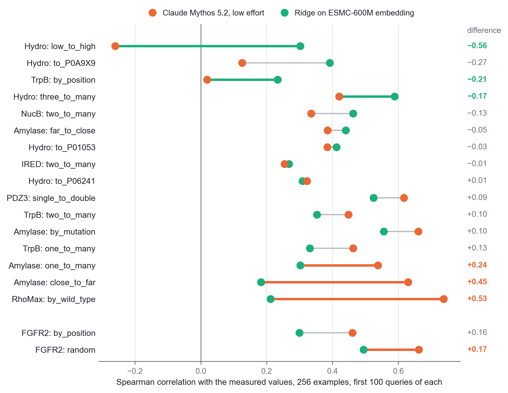

*Each split, first 100 queries: Claude Mythos 5.2 and the best ridge. A thick line marks a difference whose 95% interval
excludes zero.*

Against the ridge on the ESMC-600M embedding the model is ahead on 3 of 16 splits (`rhomax/by_wild_type` +0.53,
`amylase/close_to_far` +0.45, `amylase/one_to_many` +0.24), behind on 3 (`hydro/low_to_high` -0.56,
`trpb/by_position` -0.21, `hydro/three_to_many` -0.17), and undecided on 10. On `hydro/low_to_high` every test value
lies above the training range, and the model's Spearman is negative.

### It learns from the rows, and it also knows the protein

Each control changes one thing about the prompt. They ran on one split per dataset, the probe splits.

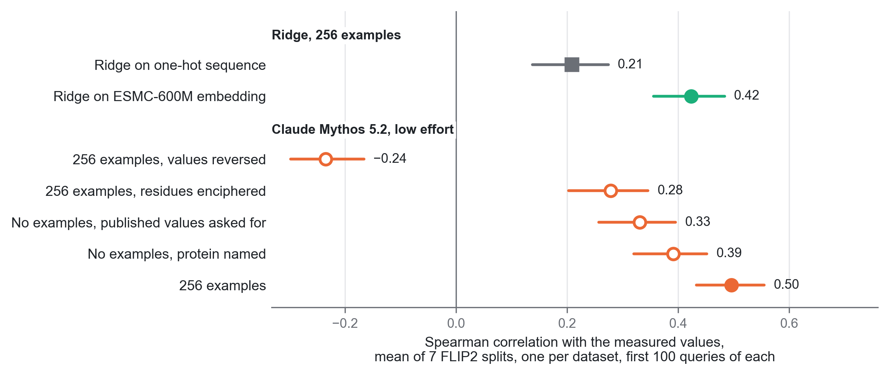

*Mean Spearman over the 7 FLIP2 probe splits, first 100 queries. The filled dot is the plain prompt and each hollow dot
one changed version.*

| 7 FLIP2 probe splits | Mean Spearman | Reading |
|---|---|---|
| 256 examples | 0.496 (0.433 to 0.555) | Ridge on the ESMC-600M embedding scores 0.423 |
| 256 examples, residues enciphered | 0.278 (0.203 to 0.346) | The protein cannot be recognized. Still +0.070 over one-hot ridge (0.209) |
| 256 examples, values reversed | -0.235 (-0.298 to -0.166) | The ranking follows the rows, not what the model believed |
| No examples, protein named | 0.391 (0.320 to 0.452) | The zero-shot score of ESMC-6B is 0.318 |
| 256 examples, high effort | 0.523 (0.461 to 0.576) | +0.027 (-0.012 to +0.068) over low effort |

Reversed values reverse the ranking on six of eight datasets, the post-cutoff one among them. About half of the score
needs the protein to be recognizable, and with no examples the model is level with a protein language model's
zero-shot score.

| Split | No examples | 256 examples | Enciphered | Reversed | Ridge, ESMC-600M embedding | Ridge, one-hot |
|---|---|---|---|---|---|---|
| `amylase/by_mutation` | 0.347 | 0.661 | 0.539 | -0.589 | 0.556 | 0.500 |
| `hydro/three_to_many` | 0.125 | 0.420 | 0.232 | -0.404 | 0.588 | -0.020 |
| `ired/two_to_many` | 0.294 | 0.254 | 0.178 | 0.050 | 0.268 | -0.045 |
| `nucb/two_to_many` | 0.422 | 0.335 | 0.113 | -0.298 | 0.463 | 0.011 |
| `pdz3/single_to_double` | 0.613 | 0.617 | 0.523 | -0.543 | 0.525 | 0.522 |
| `rhomax/by_wild_type` | 0.658 | 0.737 | -0.020 | 0.583 | 0.212 | 0.085 |
| `trpb/two_to_many` | 0.281 | 0.448 | 0.382 | -0.444 | 0.353 | 0.407 |
| `fgfr2/random` (after the cutoff) | 0.378 | 0.662 | 0.342 | -0.493 | 0.494 | 0.462 |

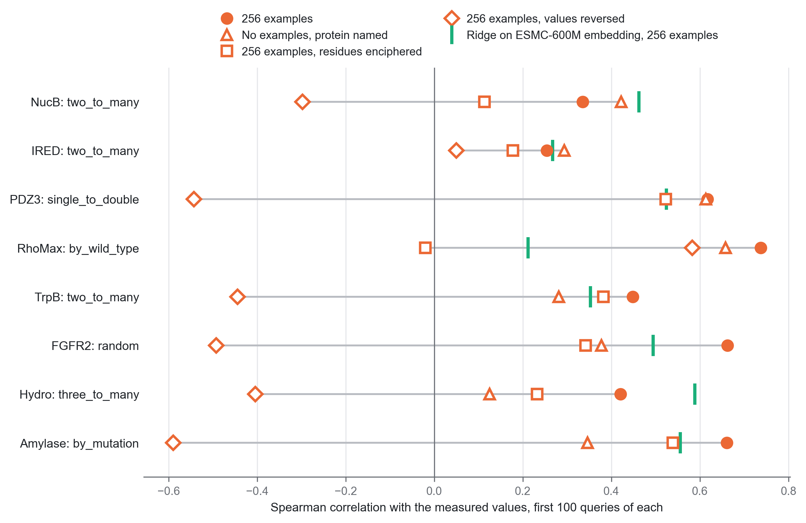

*Each probe split under four versions of the prompt, beside the ridge on the ESMC-600M embedding.*

Rhomax is the exception. The model scores 0.658 there with no examples, 0.583 against reversed rows, and -0.020 under
the cipher, so its largest lead over the ridge comes from prior knowledge of rhodopsins and is not in-context learning.
With Rhomax left out, a check added after the results were seen, the model scores 0.36 and the ridge 0.38 on the 15
other splits, a difference of -0.02 (-0.07 to +0.03).

### Memory of the benchmark

FLIP2's splits were public before the model's training data end, so three probes ask how much is recited.

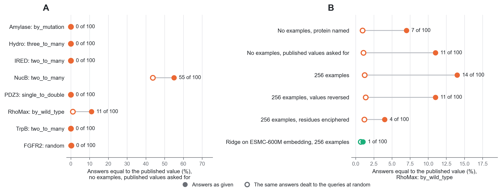

*Answers equal to the published value, against the count a random deal of the same answers gives.*

- **Published values.** Asked for the published values with no examples, the model wrote 0 of 400 exactly on the four
  probe splits with continuous values, where a random deal of its own answers gives 0.06.
- **Rhomax.** Its values are whole nanometers, and 7 to 14 of 100 answers are exact depending on the prompt, against
  about 1 from a random deal. This does not separate recall of the table from accurate knowledge of each rhodopsin.
- **Recognition.** From the parent sequence and 30 unlabeled rows the model named the protein, the measurement, and
  the source study of all seven FLIP2 datasets. For FGFR2 it named the kinase domain and gave no source.
- **Data after the cutoff.** The FGFR2 screen (MaveDB `urn:mavedb:00001329-a-3`) was published after the model's
  training data end, and the tie holds there.

### Use both

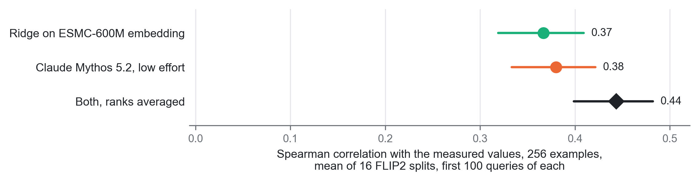

The average of the model's ranking and the best ridge's scores 0.443 (0.399 to 0.482) on FLIP2, +0.063 over the model
and +0.077 over the ridge, with both intervals above zero. On FGFR2 it reaches 0.611. The average uses equal weights
and no tuning.

### Effort

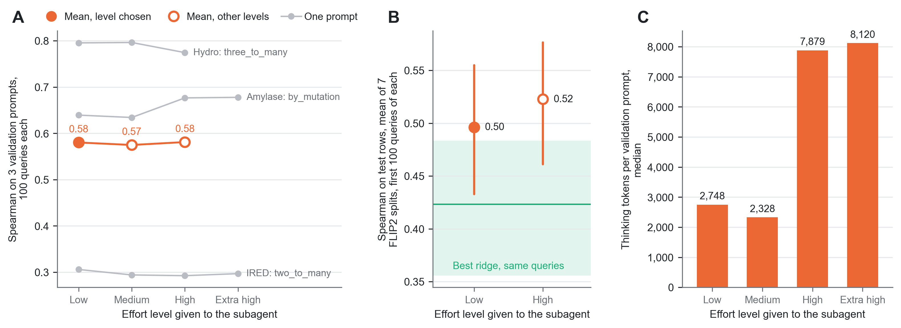

Low effort was chosen on validation rows (0.580 at low, 0.575 at medium, 0.581 at high). On test rows high effort minus
low is +0.027 (-0.012 to +0.068), and the gain is on two datasets.

## The baselines alone

On all 300 queries of each split, with no language model in the figure.

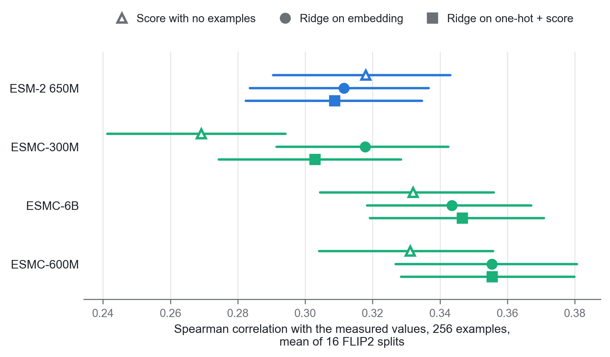

*Each protein language model as a score with no examples, as a ridge on its embedding, and as a ridge on one-hot
features with its score, on the 16 FLIP2 splits.*

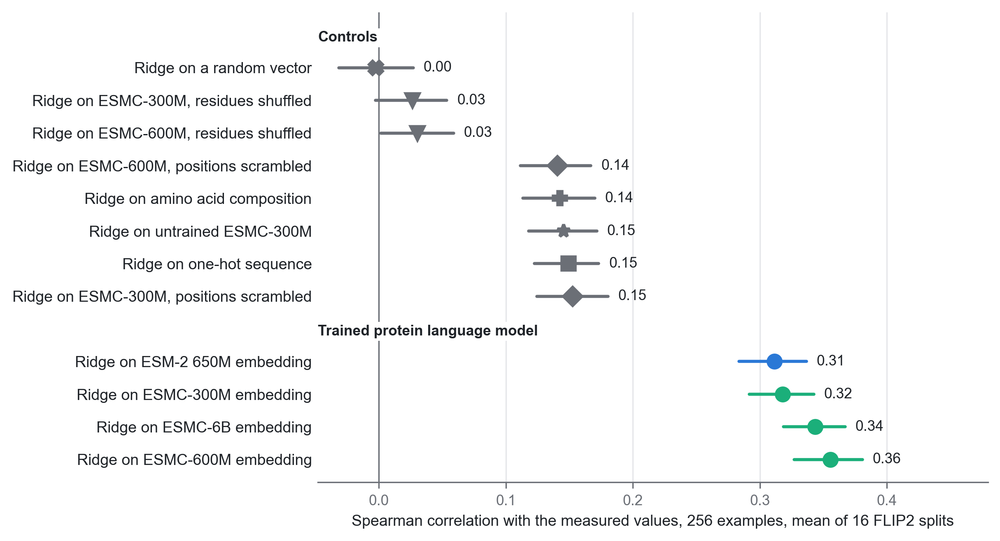

*The same ridge on features that hold less and less. A random vector scores zero, an embedding of shuffled residues 0.03,
and an untrained ESMC-300M what one-hot features do (0.145 against 0.149).*

## Claude models through the public API

A separate experiment on all 300 queries of each split, 256 examples, 16 FLIP2 splits.

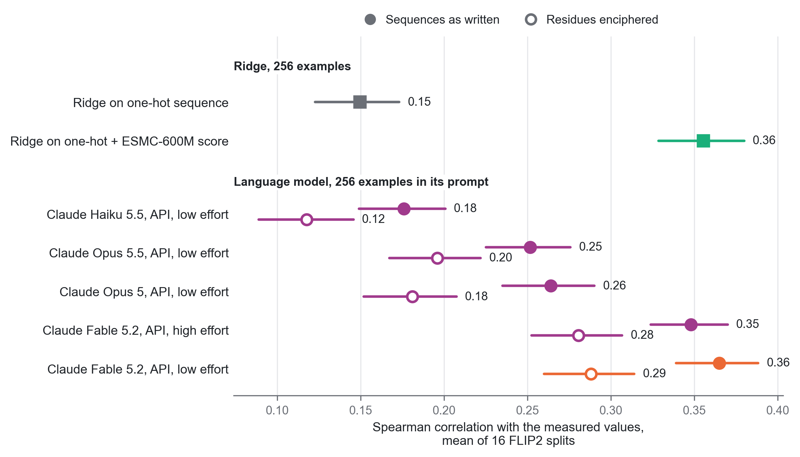

*Each API model with the prompt as written (filled) and with the residues enciphered (hollow), beside two ridges.*

| 16 FLIP2 splits, all queries | Mean Spearman |
|---|---|
| Best ridge on these queries (one-hot + ESMC-600M score) | 0.355 (0.328 to 0.380) |
| Claude Fable 5.2, low effort | 0.365 (0.339 to 0.388) |
| Claude Fable 5.2, high effort | 0.348 (0.324 to 0.370) |
| Claude Opus 5 | 0.264 |
| Claude Opus 5.5, low effort | 0.252 |
| Claude Opus 5.5, high effort | 0.219 |
| Claude Haiku 5.5 | 0.176 |

Claude Fable 5.2 ties the best ridge, +0.009 (-0.015 to +0.036) at low effort, and the three other models are below
it with intervals that exclude zero. Claude Opus 5.5 refused 68 of 265 prompts at low effort and 21 of 53 at high.

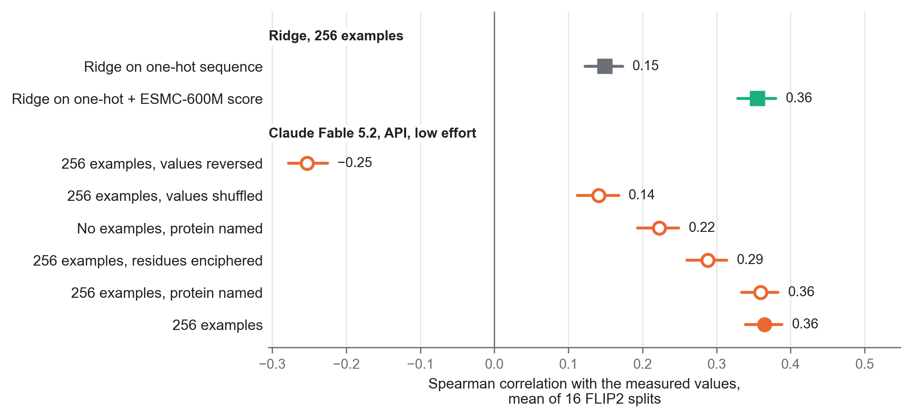

| Claude Fable 5.2, low effort, 16 FLIP2 splits | Mean Spearman |
|---|---|
| 256 examples | 0.365 |
| Protein named | 0.359 |
| Residues enciphered | 0.288 |
| No examples, protein named | 0.222 |
| Shown values shuffled | 0.141 |
| Shown values reversed | -0.253 |

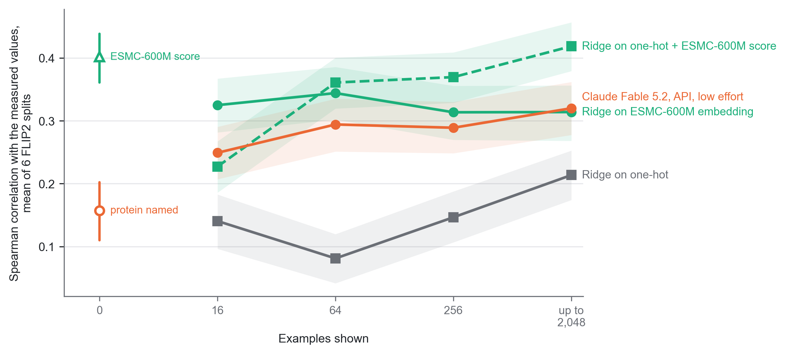

With up to 2,048 examples Claude Fable 5.2 scores 0.386 and the best ridge on the same rows 0.409, a difference of
-0.024 (-0.049 to +0.003). Asked to continue each benchmark protein's sequence, the models get this share of the next
30 residues right on the real sequence and on a shuffled one: Claude Fable 5.2 92% and 7%, Claude Opus 5.5 76% and
8%, Claude Opus 5 70% and 8%, and Claude Haiku 5.5 40% and 7%.

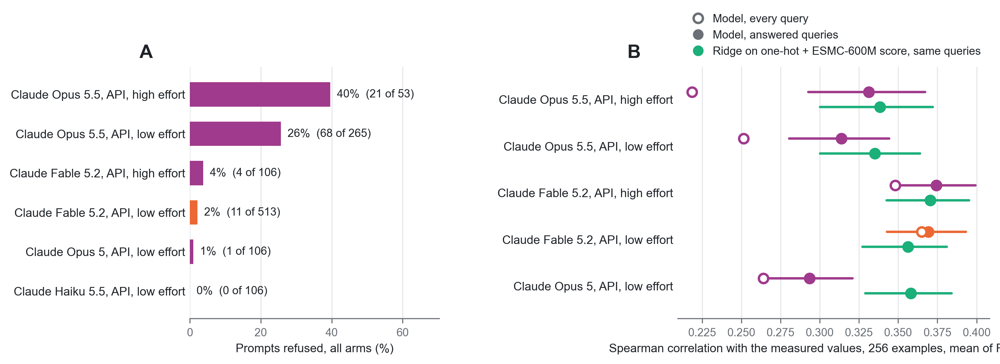

## Method

- **Data.** The 16 splits of the 7 FLIP2 datasets, and 2 splits of an FGFR2 drug-resistance screen from MaveDB that
  was published after the models' training data end.
- **Task.** 256 labeled rows drawn from a split's training part, and up to 300 test queries, 100 to a prompt. The
  prompt is plain text: one variant and its value per line, then the queries. The protein is not named.
- **Baselines.** Ridge regression on one-hot features, on the mean-pooled embedding of ESM-2 650M, ESMC-300M,
  ESMC-600M, and ESMC-6B, and on one-hot features with a model's zero-shot score. Zero-shot scores alone. All ridges
  are fit on the same 256 rows the language model reads.
- **Controls.** For the ridge: a random vector, amino acid composition, an untrained ESMC-300M, and trained ESMC
  given shuffled residues or scrambled positions. For the language model: enciphered residues, reversed values,
  shuffled values, no examples, and the protein named.
- **Score.** Spearman on each split, averaged over splits, with 95% intervals from 2,000 paired bootstrap draws of
  the queries. Every comparison uses the same queries for both sides.

## Limits

- Each Claude Mythos 5.2 score rests on one prompt of 100 queries per split, one draw of the 256 rows, and one answer
  per prompt. The intervals cover the draw of queries and not the spread between two answers to one prompt.
- The subagent route puts a coding agent's instructions in front of every prompt.
- The prompt controls for Claude Mythos 5.2 ran on one split per dataset.
- The first 100 FGFR2 queries are easier than the rest for every method (the best ridge scores 0.45 on all 300), so
  0.56 is a score on those queries and not the level of the dataset.
- Dataset recognition was marked by one reader.

## Repository

- `report/figures/`: every figure, in `mythos/`, `baselines/`, and `api/`.
- `report/tables/`: the summary tables the figures are drawn from. `means.csv` holds each method's mean and interval
  by group of splits, arm, and query scope, `per_split.csv` each split, and `paired.csv` the paired differences.
- `general_models_vs_plms/`: the package. `flip2.py` and `postcutoff.py` build the splits, `tasks.py` and `prompts.py`
  the tasks and prompt text, `plm_features.py` and `baselines.py` the baselines, `claude_calls.py` and
  `subagent_arm.py` the two routes, `report.py` the paired bootstrap, and `figures.py` the figures.
- `scripts/flip2_in_context/`: the scripts of the subagent route, and `run_all.sh`, which scores it and draws
  every figure.
- `prompts/`: every prompt Claude Mythos 5.2 was asked, as the file it read, with its answer and the instruction each
  subagent was given ([prompts/README.md](prompts/README.md)).
- `tests/`: the test suite.
- `Dockerfile`, `box.sh`: the image and the entrypoint the baselines and the API calls ran through.
- `SURVEY.md`: other public results on general language models and protein sequences.

```bash
pip install -r requirements.txt
python -m pytest tests -q
# Summaries from a run's scored tables, then the three figure sets.
python -m general_models_vs_plms.report --tables <tables> --out <summary>
python -m general_models_vs_plms.figures --summary report/tables --out figures/mythos --primary claude-mythos-5-2@harness-low
python -m general_models_vs_plms.figures --summary report/tables --out figures/api --primary claude-fable-5-2@low
```

## Running the experiments

The baselines and the API route run on one GPU machine, in the image, through `box.sh`. State is written under
`$STATE`.

```bash
bash box.sh prepare           # build the image, download FLIP2 and the FGFR2 score set, write the tasks
bash box.sh features          # ESM-2 650M and ESMC-600M features, then the baselines
bash box.sh more              # ESMC-300M, ESMC-6B, and the embedding controls
bash box.sh pilot             # API route: three effort levels on validation rows (needs ANTHROPIC_API_KEY)
bash box.sh main high low     # API route: every arm, the sequence recall probe, and the tables
```

The stages that call the Claude API spend money on every call, under a budget that `claude_calls.py` enforces.

The subagent route runs wherever the coding agent runs. It needs no API key and no GPU.

```bash
export PYTHONPATH="$PWD"
python scripts/flip2_in_context/export_sets.py --state <state> --work <work>   # prompt files under neutral names
python scripts/flip2_in_context/launch_order.py --work <work> low              # the order, and each instruction
# Start one fresh subagent per item of <work>/w_private/order.json, with the item's prompt and effort level.
STATE=<state> WORK=<work> TRANSCRIPTS=<subagent transcripts> bash scripts/flip2_in_context/run_all.sh
```

`run_all.sh` audits, scores, summarizes, and draws. It audits each subagent's transcript before it scores an answer: the model that answered, its effort level,
and that it called no tool beyond reading its prompt and writing its answer. It is written for Git Bash on Windows.
`posthoc.py` holds the analyses added after the results were seen, which are labeled so wherever they are reported.
