# Results in full

Every table and figure of the three experiments, in the order the [README](README.md) summarizes them. Each number is a
mean Spearman correlation with the measured values unless a table says otherwise, and each interval is a 95% interval
from 2,000 paired bootstrap draws of the queries. The [explainer](docs/index.html) covers the same ground step by step
for a reader outside the field, and [REPRODUCE.md](REPRODUCE.md) holds the commands.

## Every method on FLIP2 and on FGFR2

| 256 examples unless said, first 100 queries of each split | FLIP2, 16 splits | FGFR2, 2 splits |
|---|---|---|
| **Controls** | | |
| Ridge on a random vector | 0.001 (-0.048 to 0.051) | 0.025 (-0.114 to 0.164) |
| Ridge on ESMC-600M, residues shuffled | 0.002 (-0.045 to 0.051) | -0.043 (-0.185 to 0.099) |
| Ridge on ESMC-600M, positions scrambled | 0.113 (0.064 to 0.159) | 0.045 (-0.103 to 0.192) |
| Value of the nearest example | 0.138 (0.092 to 0.183) | 0.221 (0.131 to 0.298) |
| Ridge on untrained ESMC-300M | 0.141 (0.091 to 0.188) | 0.026 (-0.110 to 0.167) |
| Ridge on amino acid composition | 0.141 (0.091 to 0.186) | 0.027 (-0.106 to 0.164) |
| Ridge on one-hot sequence | 0.142 (0.097 to 0.182) | 0.295 (0.175 to 0.410) |
| **ProGen2-small** | | |
| Control: tuned on shuffled values | 0.130 (0.080 to 0.177) | 0.080 (-0.064 to 0.218) |
| Ridge on ProGen2-small hidden states | 0.192 (0.146 to 0.238) | 0.301 (0.154 to 0.429) |
| Tuned, Bradley-Terry loss | 0.234 (0.184 to 0.279) | 0.436 (0.305 to 0.552) |
| ProGen2-small score, no examples | 0.239 (0.188 to 0.286) | 0.412 (0.278 to 0.521) |
| Tuned, ranked preference loss (DPO) | 0.263 (0.214 to 0.306) | 0.314 (0.187 to 0.429) |
| **ESMC, no examples** | | |
| ESMC-300M score | 0.281 (0.233 to 0.325) | 0.464 (0.330 to 0.577) |
| ESMC-600M score | 0.341 (0.294 to 0.383) | 0.452 (0.328 to 0.564) |
| ESMC-6B score | 0.346 (0.298 to 0.388) | 0.481 (0.355 to 0.601) |
| **ESMC + ridge** | | |
| Ridge on ESMC-300M embedding | 0.288 (0.238 to 0.332) | 0.344 (0.213 to 0.471) |
| Ridge on one-hot + ESMC-300M score | 0.314 (0.264 to 0.354) | 0.555 (0.450 to 0.644) |
| Ridge on ESMC-6B embedding | 0.352 (0.304 to 0.389) | 0.359 (0.222 to 0.481) |
| Ridge on one-hot + ESMC-600M score | 0.364 (0.315 to 0.402) | 0.549 (0.450 to 0.637) |
| Ridge on one-hot + ESMC-6B score | 0.365 (0.315 to 0.404) | 0.572 (0.469 to 0.663) |
| Ridge on ESMC-600M embedding | 0.367 (0.319 to 0.409) | 0.397 (0.255 to 0.514) |
| **General language model** | | |
| Claude Mythos 5.2, 256 examples in its prompt | 0.380 (0.333 to 0.421) | 0.561 (0.458 to 0.646) |

ESM-2 650M on the same queries: 0.335 with no examples, 0.292 as a ridge on its embedding, and 0.312 as a ridge on
one-hot features with its score on FLIP2, and 0.454, 0.377, and 0.559 on FGFR2.

The rule was fixed before any model was asked: in-context learning outperforms if its paired difference from the best
ridge has a 95% interval above zero. The best ridge is chosen on the queries it is scored on, which favors the ridge.

## Two experiments, kept apart

| | Claude Mythos 5.2 | Claude models on the public API |
|---|---|---|
| How it was asked | One fresh subagent of a coding agent per prompt | One Messages API request per prompt |
| Models | Claude Mythos 5.2 | Claude Fable 5.2, Opus 5.5, Opus 5, Haiku 5.5 |
| Queries scored | The first 100 of each split | All 300 of each split |
| Thinking at the level named low | A median of 2,156 tokens a prompt | None |

The two routes differ in the queries, in what surrounds the prompt, and in how much the model thinks, so a gap between
them is not a gap between models. No figure and no table here puts one beside the other. Each is compared only with
baselines scored on its own queries.

## Claude Mythos 5.2

### The tie is an average of large wins and large losses

*Each split, first 100 queries: Claude Mythos 5.2 and the best ridge. A thick line marks a difference whose 95% interval
excludes zero.*

Against the ridge on the ESMC-600M embedding the model is ahead on 3 of 16 splits (`rhomax/by_wild_type` +0.53,
`amylase/close_to_far` +0.45, `amylase/one_to_many` +0.24), behind on 3 (`hydro/low_to_high` -0.56,
`trpb/by_position` -0.21, `hydro/three_to_many` -0.17), and undecided on 10. On `hydro/low_to_high` every test value
lies above the training range, and the model's Spearman is negative.

### It learns from the rows, and it also knows the protein

Each control changes one thing about the prompt. They ran on one split per dataset, the probe splits.

*Mean Spearman over the 7 FLIP2 probe splits, first 100 queries. The filled dot is the plain prompt and each hollow dot
one changed version.*

| 7 FLIP2 probe splits | Mean Spearman | Reading |
|---|---|---|
| 256 examples | 0.496 (0.433 to 0.555) | Ridge on the ESMC-600M embedding scores 0.423 |
| 256 examples, residues enciphered | 0.278 (0.203 to 0.346) | The protein cannot be recognized. Still +0.070 over one-hot ridge (0.209) |
| 256 examples, values reversed | -0.235 (-0.298 to -0.166) | The ranking follows the rows, not what the model believed |
| No examples, protein named | 0.391 (0.320 to 0.452) | The zero-shot score of ESMC-6B is 0.318 |
| 256 examples, high effort | 0.523 (0.461 to 0.576) | +0.027 (-0.012 to +0.068) over low effort |

Reversed values reverse the ranking on six of eight datasets, the post-cutoff one among them. About half of the score
needs the protein to be recognizable, and with no examples the model is level with a protein language model's
zero-shot score.

| Split | No examples | 256 examples | Enciphered | Reversed | Ridge, ESMC-600M embedding | Ridge, one-hot |
|---|---|---|---|---|---|---|
| `amylase/by_mutation` | 0.347 | 0.661 | 0.539 | -0.589 | 0.556 | 0.500 |
| `hydro/three_to_many` | 0.125 | 0.420 | 0.232 | -0.404 | 0.588 | -0.020 |
| `ired/two_to_many` | 0.294 | 0.254 | 0.178 | 0.050 | 0.268 | -0.045 |
| `nucb/two_to_many` | 0.422 | 0.335 | 0.113 | -0.298 | 0.463 | 0.011 |
| `pdz3/single_to_double` | 0.613 | 0.617 | 0.523 | -0.543 | 0.525 | 0.522 |
| `rhomax/by_wild_type` | 0.658 | 0.737 | -0.020 | 0.583 | 0.212 | 0.085 |
| `trpb/two_to_many` | 0.281 | 0.448 | 0.382 | -0.444 | 0.353 | 0.407 |
| `fgfr2/random` (after the cutoff) | 0.378 | 0.662 | 0.342 | -0.493 | 0.494 | 0.462 |

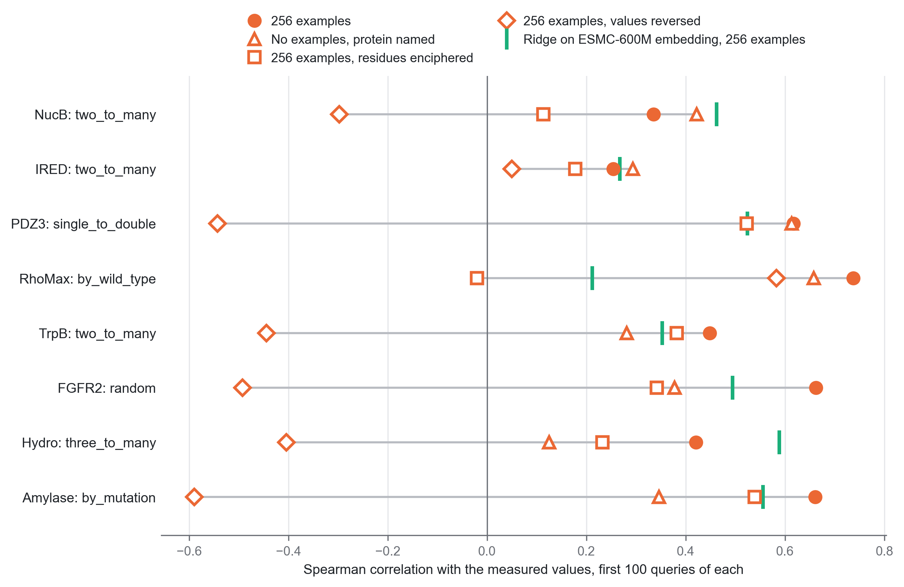

*Each probe split under four versions of the prompt, beside the ridge on the ESMC-600M embedding.*

Rhomax is the exception. The model scores 0.658 there with no examples, 0.583 against reversed rows, and -0.020 under
the cipher, so its largest lead over the ridge comes from prior knowledge of rhodopsins and is not in-context learning.
With Rhomax left out, a check added after the results were seen, the model scores 0.36 and the ridge 0.38 on the 15
other splits, a difference of -0.02 (-0.07 to +0.03).

### Memory of the benchmark

FLIP2's splits were public before the model's training data end, so three probes ask how much is recited.

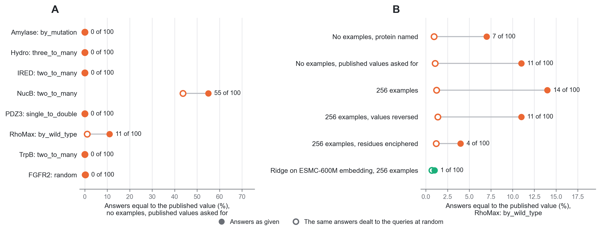

*Answers equal to the published value, against the count a random deal of the same answers gives.*

Asked for the published values with no examples, the model wrote 0 of 400 exactly on the four probe splits with
continuous values, where a random deal of its own answers gives 0.06.

Rhomax is a separate case, because its values are whole nanometers and 7 to 14 of 100 answers are exact depending on the prompt, against about 1 from a
random deal. This does not separate recall of the table from accurate knowledge of each rhodopsin.

From the parent sequence and 30 unlabeled rows the model named the protein, the measurement, and the source study of
all seven FLIP2 datasets. For FGFR2 it named the kinase domain and gave no source.

The FGFR2 screen (MaveDB `urn:mavedb:00001329-a-3`) was published after the model's training data end, and the tie
holds there.

### Knowing a sequence is not predicting its property

Does the model score well on the proteins it knows best? Pseudo-log-likelihood (PPLL) measures how well a masked
language model knows a sequence: the mean log-probability it gives each residue when that one position is masked.
Claude Mythos 5.2 returns no probabilities, so it was asked to fill in sequences with 15%, 50%, and 85% of the residues
hidden, and the share it gets right stands in for PPLL. The sequences are the 6 dataset parents, 48 Rhomax queries,
and 12 shuffled copies, and the protein language models read the same masks.

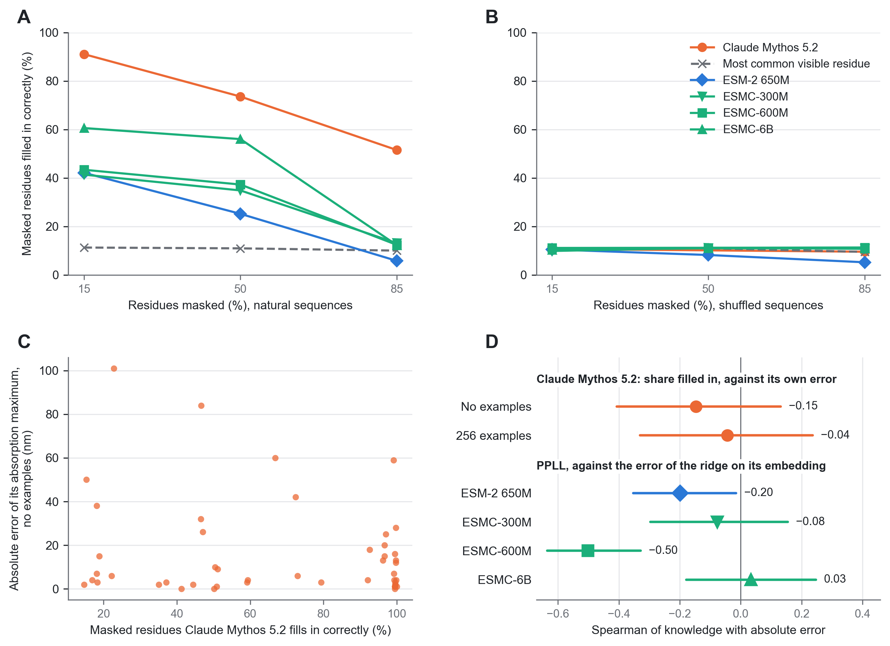

*A, B. Masked residues filled in correctly on natural and on shuffled sequences. C. One dot per rhodopsin: the share
Claude Mythos 5.2 fills in against the error of the absorption maximum it predicts with no examples. D. Spearman
across rhodopsins between knowledge of a sequence and absolute error on it, with 95% intervals.*

| Share of masked residues right | 15% masked | 50% masked | 85% masked |
|---|---|---|---|
| Claude Mythos 5.2, 48 rhodopsins | 0.914 | 0.758 | 0.568 |
| Claude Mythos 5.2, 6 parents | 0.880 | 0.562 | 0.095 |
| ESMC-6B, 48 rhodopsins | 0.594 | 0.540 | 0.125 |
| ESMC-600M, 48 rhodopsins | 0.412 | 0.341 | 0.127 |
| Most common visible residue, 48 rhodopsins | 0.110 | 0.112 | 0.102 |
| Claude Mythos 5.2, 12 shuffled copies | 0.107 | 0.101 | 0.096 |

A sequence comes back nearly whole or at the rate of a guess. The model returned 34, 32, and 23 of the 48 rhodopsins
at least 90% right at the three levels, and 19 at all three. It wrote out FGFR2 and TrpB with half the residues
hidden, and amylase and PDZ3 with 15% hidden. No protein language model reached 90% on any rhodopsin. The FGFR2 screen
is new to the model, and the FGFR2 sequence is not.

Across the 48 rhodopsins, the share the model fills in has a Spearman of -0.15 (-0.41 to +0.13) with its absolute
error on the absorption maximum with no examples, and -0.04 (-0.33 to +0.24) with 256 examples. In a check added after
the results were seen, the 8 rhodopsins it wrote out at no level have a median error of 3.5 nm and the 19 it wrote out
at every level 4.0 nm.

Across 100 rhodopsins, PPLL against the error of the ridge on the same model's embedding gives -0.50 (-0.64 to -0.33)
for ESMC-600M, -0.20 (-0.35 to -0.02) for ESM-2 650M, -0.08 (-0.30 to +0.15) for ESMC-300M, and +0.03 (-0.18 to +0.25)
for ESMC-6B. The three ESMC models rank the rhodopsins by PPLL nearly alike (Spearman 0.82 to 0.95), so the relation
belongs to one model's ridge.

Rhomax is the one dataset here in which each query is its own natural sequence, so it is the only place the question
can be asked per sequence. Forty-eight sequences detect a correlation of about 0.4 or more, each prompt was asked
once, and the rhodopsins include variants of shared wild types. This test does not separate knowledge of the family
from memory of measured values. The tables are in `report/tables/sequence_knowledge/`.

### Use both

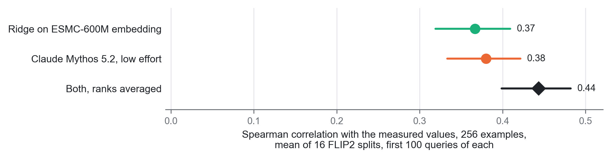

The average of the model's ranking and the best ridge's scores 0.443 (0.399 to 0.482) on FLIP2, +0.063 over the model
and +0.077 over the ridge, with both intervals above zero. On FGFR2 it reaches 0.611. The average uses equal weights
and no tuning.

### Effort

Low effort was chosen on validation rows (0.580 at low, 0.575 at medium, 0.581 at high). On test rows high effort minus
low is +0.027 (-0.012 to +0.068), and the gain is on two datasets.

## ProGen2-small tuned on the same rows

A ridge leaves its protein model as it is. Preference tuning changes every weight, so that a variant with a higher
measured value gets a higher likelihood, and it is the usual way to adapt a generative protein language model to a
few measurements. ProGen2-small (151 million weights) was tuned on 205 of the 256 rows of each split, and the
learning rate (0.00001 or 0.0001), the weight of the loss (0.1 or 2), and the epoch (up to 20) were chosen by Spearman
on the other 51. `pdz3/single_to_double` has 124 labeled rows and no more, so there 73 rows tune and 51 choose. The
ranked preference loss, Direct Preference Optimization (DPO), is the primary arm, and the rule is the one of the
first experiment: a paired difference whose 95% interval excludes zero is a win or a loss.

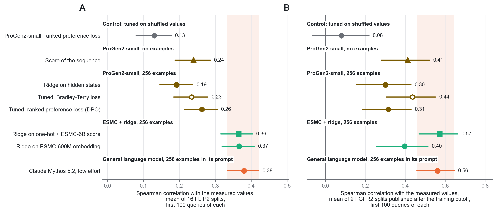

*Mean Spearman with 95% intervals, first 100 queries of each split. A, the 16 FLIP2 splits. B, the 2 FGFR2 splits.
Olive rows are ProGen2-small, the gray row is the same tuning on shuffled values, green rows are the best ridges on
ESMC features, and orange is Claude Mythos 5.2, whose interval is the shaded band.*

| 16 FLIP2 splits, first 100 queries | Mean Spearman | Minus Claude Mythos 5.2 | Minus the best ridge |
|---|---|---|---|
| Control: tuned on shuffled values | 0.130 (0.080 to 0.177) | -0.250 (-0.307 to -0.192) | -0.237 (-0.298 to -0.172) |
| Ridge on ProGen2-small hidden states | 0.192 (0.146 to 0.238) | -0.187 (-0.238 to -0.136) | -0.174 (-0.223 to -0.124) |
| Tuned, Bradley-Terry loss | 0.234 (0.184 to 0.279) | -0.146 (-0.197 to -0.092) | -0.132 (-0.190 to -0.076) |
| ProGen2-small score, no examples | 0.239 (0.188 to 0.286) | -0.141 (-0.196 to -0.087) | -0.127 (-0.186 to -0.067) |
| Tuned, ranked preference loss (DPO) | 0.263 (0.214 to 0.306) | -0.117 (-0.163 to -0.071) | -0.104 (-0.159 to -0.050) |
| The same, second batch order | 0.267 (0.219 to 0.309) | -0.113 (-0.160 to -0.069) | -0.100 (-0.155 to -0.045) |
| The same, third batch order | 0.262 (0.215 to 0.303) | -0.118 (-0.165 to -0.070) | -0.105 (-0.162 to -0.050) |
| Best ridge, on the ESMC-600M embedding | 0.367 (0.319 to 0.409) | -0.013 (-0.065 to +0.038) | |
| Claude Mythos 5.2, 256 examples in its prompt | 0.380 (0.333 to 0.421) | | +0.013 (-0.038 to +0.065) |

The tuned model is behind both methods, with intervals below zero, under each of three batch orders. Split by split
it is ahead of Claude Mythos 5.2 on 1 of 16, behind on 7, and undecided on 8, and ahead of the ridge on 1, behind on
5, and undecided on 10. On the two FGFR2 splits it scores 0.314, which is -0.247 (-0.385 to -0.119) from Claude
Mythos 5.2 and -0.257 (-0.403 to -0.112) from the best ridge there.

### The control

Tuning on shuffled values starts from the released weights, so it is read against the released model's score and not
against zero. It scores -0.109 (-0.163 to -0.054) from that score on FLIP2 and -0.333 (-0.525 to -0.133) on FGFR2,
which is what a tuning that learns nothing about the queries should do, and tuning on the measured values scores
+0.133 (+0.068 to +0.199) above it. This reading replaced the planned one, that the control score near zero, after
the first two splits were scored and before the others were read.

### Tuning learns the rows and does not improve on the released model

On the 51 held-out rows the mean Spearman over the FLIP2 splits rises from 0.245 for the released model to 0.628 at
the chosen checkpoint, where the control reaches 0.199 on its own shuffled rows by the same choice among 80
checkpoints. On the test queries the ranked loss is +0.023 (-0.036 to +0.082) from the released model and the
Bradley-Terry loss -0.005 (-0.058 to +0.047). The released model is itself -0.102 (-0.142 to -0.061) from the score
ESMC-600M gives with no examples, and the tuned model stays below that score (-0.079, -0.135 to -0.022) and above the
one-hot ridge (+0.121, +0.066 to +0.176).

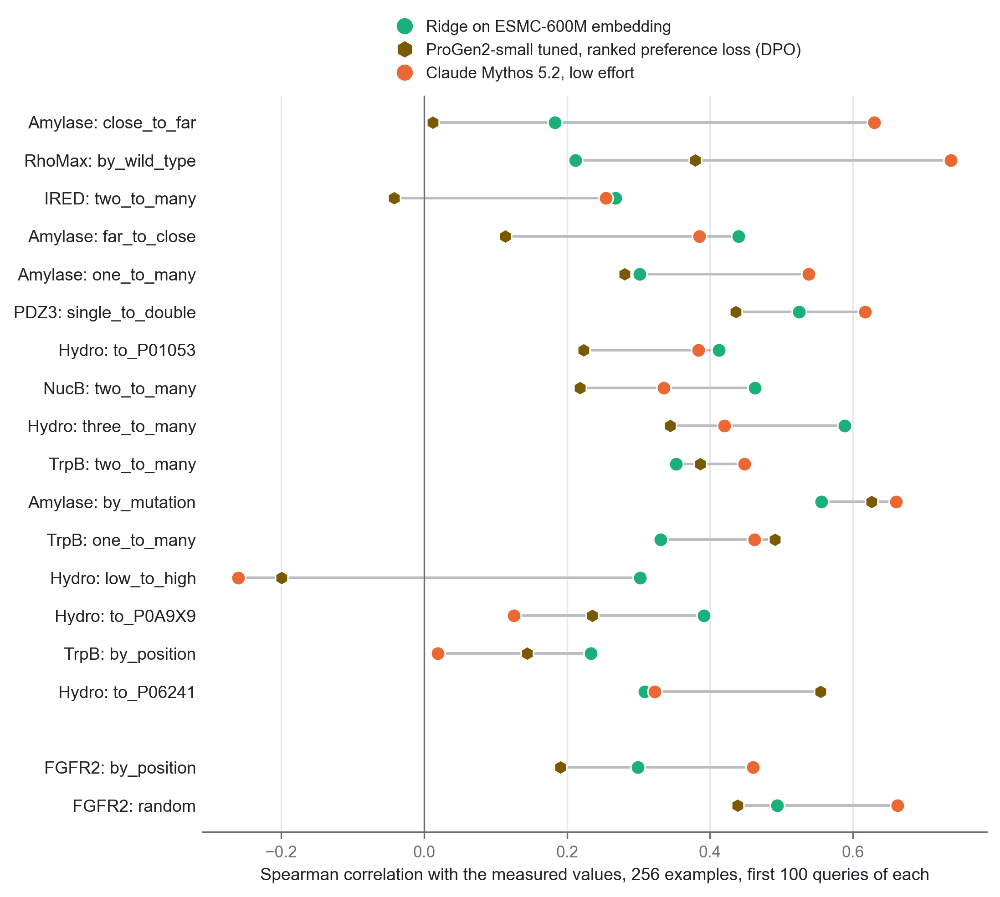

*Each split, first 100 queries: ProGen2-small tuned with the ranked preference loss (olive hexagon), Claude Mythos 5.2
(orange), and the ridge on the ESMC-600M embedding (green). The FLIP2 splits run from the one where tuning trails
Claude Mythos 5.2 most to the one where it leads most, and the two FGFR2 splits are below them.*

| Split | Held-out rows, released | Held-out rows, tuned | No examples | Tuned (DPO) | Tuned on shuffled values | Ridge, ESMC-600M embedding | Claude Mythos 5.2 | Tuned minus Claude Mythos 5.2 |
|---|---|---|---|---|---|---|---|---|
| `amylase/by_mutation` | 0.073 | 0.593 | 0.346 | 0.626 | -0.181 | 0.556 | 0.661 | -0.035 (-0.146 to +0.075) |
| `amylase/close_to_far` | 0.193 | 0.426 | 0.293 | 0.012 | -0.072 | 0.183 | 0.630 | -0.618 (-0.832 to -0.413) |
| `amylase/far_to_close` | 0.293 | 0.596 | 0.318 | 0.113 | 0.036 | 0.440 | 0.385 | -0.272 (-0.514 to -0.025) |
| `amylase/one_to_many` | 0.420 | 0.403 | 0.013 | 0.281 | -0.076 | 0.302 | 0.538 | -0.257 (-0.426 to -0.103) |
| `hydro/low_to_high` | -0.040 | 0.365 | 0.314 | -0.199 | 0.189 | 0.302 | -0.260 | +0.061 (-0.062 to +0.178) |
| `hydro/three_to_many` | 0.083 | 0.718 | 0.374 | 0.344 | 0.306 | 0.588 | 0.420 | -0.076 (-0.230 to +0.086) |
| `hydro/to_P01053` | 0.214 | 0.628 | 0.144 | 0.223 | 0.223 | 0.412 | 0.384 | -0.161 (-0.292 to -0.024) |
| `hydro/to_P06241` | 0.530 | 0.728 | 0.444 | 0.555 | 0.447 | 0.309 | 0.323 | +0.232 (+0.044 to +0.403) |
| `hydro/to_P0A9X9` | 0.177 | 0.645 | 0.153 | 0.235 | 0.167 | 0.392 | 0.126 | +0.110 (-0.036 to +0.246) |
| `ired/two_to_many` | 0.249 | 0.329 | 0.145 | -0.042 | -0.036 | 0.268 | 0.254 | -0.296 (-0.545 to -0.048) |
| `nucb/two_to_many` | 0.029 | 0.579 | 0.148 | 0.218 | -0.126 | 0.463 | 0.335 | -0.117 (-0.346 to +0.113) |
| `pdz3/single_to_double` | -0.131 | 0.862 | -0.046 | 0.436 | 0.120 | 0.525 | 0.617 | -0.181 (-0.324 to -0.036) |
| `rhomax/by_wild_type` | -0.089 | 0.877 | 0.421 | 0.379 | 0.533 | 0.212 | 0.737 | -0.358 (-0.534 to -0.184) |
| `trpb/by_position` | 0.768 | 0.796 | 0.156 | 0.144 | 0.077 | 0.233 | 0.019 | +0.126 (-0.151 to +0.392) |
| `trpb/one_to_many` | 0.664 | 0.800 | 0.351 | 0.491 | 0.128 | 0.331 | 0.463 | +0.029 (-0.093 to +0.156) |
| `trpb/two_to_many` | 0.481 | 0.704 | 0.256 | 0.386 | 0.344 | 0.353 | 0.448 | -0.062 (-0.226 to +0.086) |
| `fgfr2/by_position` (after the cutoff) | 0.444 | 0.686 | 0.388 | 0.190 | 0.125 | 0.299 | 0.461 | -0.270 (-0.492 to -0.042) |
| `fgfr2/random` (after the cutoff) | 0.343 | 0.546 | 0.437 | 0.439 | 0.035 | 0.494 | 0.662 | -0.224 (-0.377 to -0.076) |

Against the released model, tuning gains most on `pdz3/single_to_double` (+0.48), `amylase/by_mutation` (+0.28), and
`amylase/one_to_many` (+0.27), whose test variants are mutated at positions the examples also mutate. It loses most
on `hydro/low_to_high` (-0.51), where every test value lies above the examples' values, and on `amylase/close_to_far`
(-0.28), `amylase/far_to_close` (-0.21), and `fgfr2/by_position` (-0.20), where the test variants are mutated at
positions no example touches. These readings were made after the results were seen, as was the next one: the tuned
model's scores of the queries have a mean Spearman of 0.27 with the released model's scores of the same queries, so
tuning replaces most of the released ranking.

On all 300 queries of each split, where only the ridges can be compared, the tuned model scores 0.256 (0.229 to
0.281) on FLIP2 and the best ridge on those queries 0.355, a difference of -0.100 (-0.132 to -0.069). On all FGFR2
queries the picture differs from the first 100: the ranked loss scores 0.382 and the Bradley-Terry loss 0.452, where
the best ridge scores 0.458, and both differences have intervals that include zero.

What each arm chose on each split is in `report/tables/preference_tuning.csv`.

### With no shift between examples and test, the tuned model is still behind the ridge on ESMC

The test queries of a FLIP2 split come from outside its examples, and the 51 held-out rows do not. To separate the
method from that shift, every baseline was also fit on the 205 tuning rows and scored on the 51 held-out rows. The
tuned model is read after a fixed number of epochs of the setting most splits chose (learning rate 0.00001, weight
2), so that the rows it is scored on did not choose its checkpoint.

| 16 FLIP2 splits | Mean Spearman on the 51 held-out rows | Tuned for 5 epochs, minus this method | Splits where tuned is ahead | Mean Spearman on the first 100 test queries |
|---|---|---|---|---|
| ProGen2-small as released | 0.245 | | | 0.239 |
| ESMC-600M score, no examples | 0.391 | +0.130 (-0.011 to +0.290) | 10 | 0.341 |
| Value of the nearest example | 0.490 | +0.031 (-0.040 to +0.092) | 11 | 0.138 |
| ProGen2-small tuned, 5 epochs | 0.522 | | | |
| ProGen2-small tuned, 20 epochs | 0.527 | | | |
| Ridge on one-hot sequence | 0.571 | -0.050 (-0.126 to +0.018) | 7 | 0.142 |
| Ridge on ProGen2-small hidden states | 0.572 | -0.051 (-0.122 to +0.021) | 6 | 0.192 |
| Ridge on ProGen2-base hidden states | 0.600 | -0.078 (-0.150 to -0.016) | 5 | 0.243 |
| ProGen2-small tuned, at the checkpoint these rows chose | 0.628 | | | 0.263 |
| Ridge on the ESMC-600M embedding | 0.637 | -0.116 (-0.185 to -0.053) | 4 | 0.367 |
| Ridge on one-hot with the ESMC-6B score | 0.645 | -0.124 (-0.212 to -0.049) | 4 | 0.365 |
| Ridge on the ESMC-6B embedding | 0.651 | -0.130 (-0.221 to -0.045) | 4 | 0.352 |

A difference here is the mean over the 16 splits with an interval from resampling the splits, because the run kept
one Spearman a split on these rows and not a score for each row. On rows drawn like its examples the tuned model is
level with a one-hot ridge and 0.12 below the ridge on the ESMC-600M embedding, about the gap it shows on the test
queries (0.10). It reaches the ESMC ridge only at the checkpoint the scored rows chose, which is the best of 80 on
those rows (-0.009, -0.041 to +0.025). The shift then costs every method: from the held-out rows to the test queries
the ESMC-600M ridge falls from 0.637 to 0.367, the tuned model from between 0.52 and 0.63 to 0.263, and the one-hot
ridge from 0.571 to 0.142. The tables are `preference_inside.csv` and `preference_inside_differences.csv`.

Part of that gap belongs to the model and not to the tuning. A ridge on ProGen2-small's own hidden states scores
0.572 on these rows, level with the one-hot ridge and -0.065 (-0.112 to -0.021) from the ridge on the ESMC-600M
embedding, and a ridge on ProGen2-base's states scores 0.600. The same model is better under a ridge than tuned on
rows like its examples (0.572 against 0.52), and better tuned than under a ridge on the test queries (0.339 for the
fixed recipe against 0.192), so tuning is the use that carries across the shift.

### Every epoch of every setting

The reported run kept one checkpoint a split. A second run of the ranked loss scored the first 100 queries after
every epoch of all four settings, so that any other amount of tuning can be read. Comparing its cells uses the
measured values of the test queries, which the reported choice never does, so the cells say what another choice
would have scored and are not results.

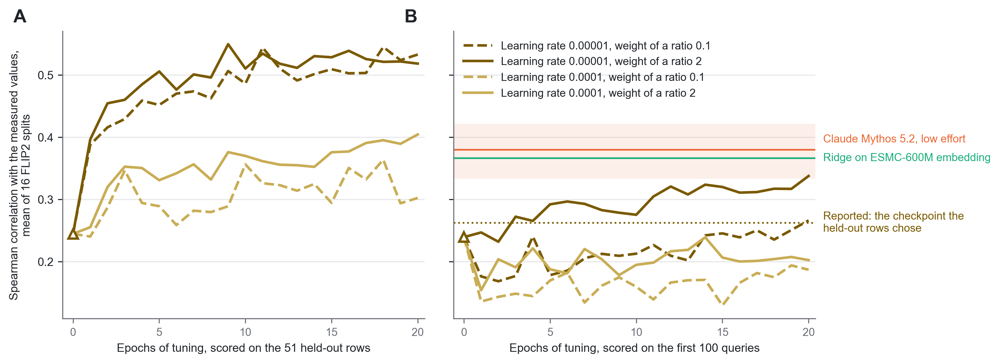

*Mean Spearman over the 16 FLIP2 splits after each epoch of tuning. A, on the 51 held-out rows, where the checkpoint
is chosen. B, on the first 100 test queries. The triangle at epoch 0 is the released model. Dark lines use the
learning rate 0.00001 and pale lines 0.0001, and a solid line uses the weight 2. In B the orange line and band are
Claude Mythos 5.2, the green line is the best ridge, and the dotted line is the reported score.*

| 16 FLIP2 splits, first 100 queries, after epoch | 1 | 2 | 5 | 10 | 15 | 20 |
|---|---|---|---|---|---|---|
| Learning rate 0.00001, weight 0.1 | 0.176 | 0.168 | 0.178 | 0.213 | 0.245 | 0.266 |
| Learning rate 0.00001, weight 2 | 0.247 | 0.232 | 0.292 | 0.275 | 0.320 | 0.338 |
| Learning rate 0.0001, weight 0.1 | 0.136 | 0.143 | 0.170 | 0.160 | 0.130 | 0.187 |
| Learning rate 0.0001, weight 2 | 0.154 | 0.204 | 0.188 | 0.195 | 0.207 | 0.202 |

The best cell is the last epoch of the lower learning rate with the weight 2, at 0.338, which is 0.075 above the
reported checkpoint and 0.03 to 0.04 below the best ridge and Claude Mythos 5.2, with the optimism of a best of 80
on its side. On the held-out rows the same setting is level from the fifth epoch (0.51 to 0.53), so those rows
cannot tell a 5-epoch model from a 20-epoch one, and the checkpoint they choose (0.272 in this run, 0.263 in the
reported one) is worse on the test queries than running the setting to its end. The best checkpoint of each split,
picked on the test queries split by split, scores 0.431, which bounds any rule for choosing a checkpoint from
above. The two runs of the same recipe agree as a mean and not split by split: at their own chosen checkpoints they
score the same on 7 of 18 splits and differ on the others by up to 0.18, because tuning on this GPU is not
bit-reproducible and a small change moves the chosen epoch.

### One setting run to a fixed length, with nothing chosen

The trace points to one recipe: the learning rate 0.00001, the weight 2, and a run to the end. That reading used the
measured values of the first 100 queries, so the recipe was run again for 40 epochs with every query of a split
scored after every epoch, and read after 20 and after 40 epochs with no checkpoint chosen. Queries 101 to 300 of
each split had no part in picking the recipe, and Claude Mythos 5.2 did not answer them, so there the tuned model is
compared with the best ridge alone.

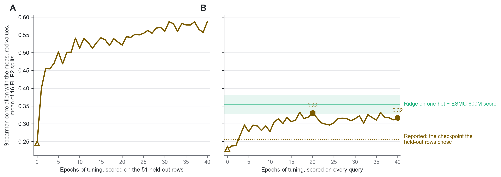

*Mean Spearman over the 16 FLIP2 splits after each epoch of the one setting. A, on the 51 held-out rows. B, on every
query of each split. The triangle at epoch 0 is the released model, the hexagons are the two epochs read with nothing
chosen, the green line and band are the best ridge on those queries, and the dotted line is the reported score.*

| 16 FLIP2 splits, 256 examples | Queries 101 to 300 | Minus the best ridge there | All 300 | Minus the best ridge there | First 100 | Minus Claude Mythos 5.2 |
|---|---|---|---|---|---|---|
| ProGen2-small, no examples | 0.226 | -0.125 (-0.162 to -0.086) | 0.229 | -0.126 (-0.156 to -0.095) | 0.239 | -0.141 (-0.196 to -0.087) |
| Reported: checkpoint chosen on the held-out rows over four settings | 0.249 (0.214 to 0.282) | -0.102 (-0.140 to -0.060) | 0.256 (0.229 to 0.281) | -0.100 (-0.132 to -0.069) | 0.263 | -0.117 (-0.163 to -0.071) |
| One setting, 20 epochs, nothing chosen | 0.324 (0.290 to 0.354) | -0.026 (-0.063 to +0.013) | 0.330 (0.303 to 0.354) | -0.025 (-0.055 to +0.002) | 0.339 (0.290 to 0.379) | -0.041 (-0.091 to +0.004) |
| One setting, 40 epochs, nothing chosen | 0.312 (0.279 to 0.345) | -0.038 (-0.073 to -0.000) | 0.317 (0.290 to 0.342) | -0.039 (-0.068 to -0.010) | 0.322 (0.273 to 0.363) | -0.058 (-0.108 to -0.011) |
| The same run, checkpoint chosen among its 40 epochs | 0.323 (0.288 to 0.353) | -0.028 (-0.063 to +0.008) | 0.322 (0.295 to 0.347) | -0.033 (-0.061 to -0.006) | 0.322 (0.274 to 0.361) | -0.058 (-0.103 to -0.014) |
| Best ridge on those queries | 0.351 | | 0.355 | | 0.367 | |

The reported arm understates preference tuning on these splits by about 0.07. On queries that had no part in picking
the recipe, the 20-epoch model is +0.075 (+0.049 to +0.102) above the reported arm and +0.098 (+0.060 to +0.136)
above the released model, and its difference from the best ridge has an interval that includes zero. After 40 epochs
the interval lies just under zero. So with a fixed recipe ProGen2-small is between a tie with the best ridge and a
small loss to it, 0.03 to 0.04 below, where the reported arm is 0.10 below.

Epoch 20 is the top of a level stretch: on queries 101 to 300 the mean is between 0.292 and 0.329 at every epoch
from 15 to 40 and averages 0.310, so about 0.31 is the safer number for the recipe. Over the same epochs the
held-out mean keeps rising, from 0.521 to 0.588, which fits rows like the examples and nothing else. On the first 100
queries, where the recipe was picked and where the comparison is therefore optimistic for the tuned model, the
20-epoch model is -0.041 (-0.091 to +0.004) from Claude Mythos 5.2 and the 40-epoch model -0.058 (-0.108 to -0.011).

About half of the 0.07 comes from five splits on which the 51 held-out rows chose another setting, where the
reported arm scores 0.135 on all queries and the fixed recipe 0.26. The other half comes from the 11 splits that
chose this setting at an earlier epoch (0.311 against 0.363 after 20 epochs). Choosing the epoch alone, within the
one setting, costs nothing. On FGFR2 the 20-epoch model scores 0.407 on queries 101 to 300 and ties the best ridge
there, and 0.342 on the first 100, -0.219 (-0.367 to -0.079) from Claude Mythos 5.2.

### A likelihood term beside the ranked loss

The ranked preference loss reads only how the rows of a batch differ from one another, so it is as low when the
likelihood of every row falls as when it rises. Iterative Reasoning Preference Optimization (Pang and colleagues,
NeurIPS 2024, [arXiv 2404.19733](https://arxiv.org/abs/2404.19733)) adds to a preference loss the negative
log-likelihood of the preferred sequence of each pair, and reports that without it the likelihood of the preferred
sequences falls during tuning. Here a batch of 8 rows is ranked, so each row is the preferred one of the pairs it
forms with the rows measured below it, and the term is the negative mean log-likelihood per residue of each pair's
preferred row, averaged over the 28 pairs of the batch. It was added to the fixed recipe of the section above
(ProGen2-small, the learning rate 0.00001, the weight 2, 20 epochs, nothing chosen) at three weights: 1, which is the
weight of that method and was named the primary run before any was scored, and 0.1 and 0.01. Each run differs from
the fixed recipe in the term alone, with the same rows, batches, and seed.

| ProGen2-small, fixed recipe, 16 FLIP2 splits | Queries 101 to 300 | Minus the recipe without the term | Minus the best ridge there | All 300 | Minus the recipe without the term | First 100 | Mean log-likelihood per residue of the queries after 20 epochs |
|---|---|---|---|---|---|---|---|
| The released model, no examples | 0.226 | | | 0.229 | | 0.239 | -2.12 |
| No term | 0.324 (0.290 to 0.354) | | -0.026 (-0.063 to +0.013) | 0.330 | | 0.339 | -7.71 |
| Weight 0.01 | 0.344 (0.310 to 0.374) | +0.020 (+0.001 to +0.039) | -0.006 (-0.041 to +0.028) | 0.346 | +0.016 (+0.002 to +0.031) | 0.352 | -3.76 |
| Weight 0.1 | 0.348 (0.314 to 0.379) | +0.024 (-0.002 to +0.051) | -0.002 (-0.036 to +0.032) | 0.357 | +0.026 (+0.006 to +0.048) | 0.378 | -1.46 |
| Weight 1, the primary run | 0.295 (0.261 to 0.327) | -0.030 (-0.063 to +0.005) | -0.056 (-0.090 to -0.020) | 0.302 | -0.028 (-0.054 to -0.003) | 0.321 | -1.03 |

Without the term the tuned model ranks the variants of a protein that it no longer models. The released model gives
the queries a mean log-likelihood of -2.12 per residue. Under the fixed recipe that mean is -2.44 after one epoch,
-4.26 after 5, and -7.71 after 20, and it is below the released model's on all 16 splits after 5, 10, 15, and 20
epochs. The term slows the fall at the weight 0.01 and stops it at 0.1 and at 1, where the mean ends above the
released model's, since the term also fits the protein that the variants of a split share.

On the ranking the primary run shows no gain. At the weight 1 the difference from the recipe without the term has an
interval that includes zero on queries 101 to 300 and lies below zero on all 300, and the model falls behind the best
ridge. At 0.1 and 0.01 the differences are positive, about 0.02: on queries 101 to 300 one interval clears zero by
0.001 and the other includes it, and on all 300 both lie above zero. Three weights were read under one batch order and
neither lighter weight was the primary run, so that gain is a lead and not a finding. The lighter weights are ahead of
the recipe without the term on 8 and on 9 of the 16 splits on queries 101 to 300, and the weight 1 on 5.

Against the two references nothing changes. With the term at 0.1 the model is level with the best ridge on queries 101
to 300 and on the first 100 (+0.011, -0.044 to +0.061), and level with Claude Mythos 5.2 on the first 100, 0.378
against 0.380 (-0.002, -0.045 to +0.038). It is above neither.

Split by split the term moves scores in both directions. At 0.1 on queries 101 to 300 the largest gains are on
`amylase/far_to_close` (0.152 to 0.395), `amylase/close_to_far` (0.250 to 0.460), and `pdz3/single_to_double` (0.395
to 0.563), and the largest losses on `hydro/to_P01053` (0.353 to 0.183) and `rhomax/by_wild_type` (0.392 to 0.270). On
the 51 held-out rows the mean Spearman after 20 epochs is 0.521 without the term, 0.538 at 0.01, 0.573 at 0.1, and
0.488 at 1. On the two FGFR2 splits the weights 0.1 and 1 score 0.471 and 0.467 on the first 100 queries, against
0.342 without the term, and 0.328 and 0.321 on queries 101 to 300, against 0.407. On all 300 FGFR2 queries the four
runs are within 0.022 of each other.

The term as that method defines it is for pairs, and weighting it over the pairs of a ranked batch is this
repository's reading of it. Each run has one batch order and no control on shuffled values, and only ProGen2-small
was run.

### Averaged with another ranking

The mean rank of each query under the reported tuned model and one other method, on the first 100 queries. Nothing
is run for these rows.

| 16 FLIP2 splits, tuned ProGen2-small averaged with | Mean Spearman | Minus the tuned model alone | Minus the other method alone |
|---|---|---|---|
| Its two other batch orders | 0.282 (0.232 to 0.325) | +0.019 (-0.001 to +0.038) | |
| Its own score with no examples | 0.306 (0.257 to 0.348) | +0.043 (+0.011 to +0.077) | +0.067 (+0.033 to +0.100) |
| The ESMC-600M score with no examples | 0.380 (0.334 to 0.419) | +0.117 (+0.083 to +0.150) | +0.039 (+0.006 to +0.072) |
| The ridge on the ESMC-600M embedding | 0.391 (0.343 to 0.431) | +0.129 (+0.098 to +0.159) | +0.025 (-0.006 to +0.054) |
| Claude Mythos 5.2 | 0.366 (0.318 to 0.406) | +0.103 (+0.078 to +0.129) | -0.014 (-0.042 to +0.012) |

The three batch orders together are still -0.085 (-0.138 to -0.029) from the best ridge and -0.098 (-0.143 to
-0.055) from Claude Mythos 5.2, so the spread between runs of one recipe is not the gap. The tuned and the released
ranking together beat either alone, which fits their correlation of 0.27: tuning swaps one ranking for another that
is about as good. With the best ridge or with Claude Mythos 5.2 the average ties the other method alone, where the
ridge and Claude Mythos 5.2 averaged with each other gain 0.06 to 0.08 over either.

### A larger model: ProGen2-base

ProGen2-base has 764 million weights, five times ProGen2-small. It was scored with no examples and under a ridge on
its hidden states, and tuned on the same 205 rows two ways: with the weight (0.1 or 2) and the epoch chosen on the
same 51 rows at the learning rate 0.00001, and with the fixed recipe of the section above for 20 epochs with nothing
chosen. Each has one batch order and no control on shuffled values.

| 256 examples | FLIP2, first 100 queries | FLIP2, queries 101 to 300 | FLIP2, all 300 | FGFR2, first 100 | FGFR2, all 300 |
|---|---|---|---|---|---|
| ProGen2-small, no examples | 0.239 | 0.226 | 0.229 | 0.412 | 0.303 |
| ProGen2-small, fixed recipe, 20 epochs | 0.339 | 0.324 | 0.330 | 0.342 | 0.392 |
| ProGen2-base, no examples | 0.276 (0.226 to 0.322) | 0.271 (0.237 to 0.304) | 0.274 (0.245 to 0.299) | 0.392 | 0.301 |
| ProGen2-base, ridge on its hidden states | 0.243 (0.193 to 0.286) | 0.239 (0.202 to 0.273) | 0.240 (0.212 to 0.267) | 0.373 | 0.353 |
| ProGen2-base tuned, checkpoint chosen on the held-out rows | 0.308 (0.258 to 0.349) | 0.265 (0.230 to 0.295) | 0.282 (0.254 to 0.306) | 0.232 (0.090 to 0.368) | 0.264 (0.188 to 0.344) |
| ProGen2-base, fixed recipe, 20 epochs, nothing chosen | 0.360 (0.314 to 0.401) | 0.339 (0.305 to 0.369) | 0.347 (0.320 to 0.372) | 0.379 (0.241 to 0.499) | 0.361 (0.285 to 0.427) |
| Best ridge on those queries | 0.367 | 0.351 | 0.355 | 0.572 | 0.458 |
| Claude Mythos 5.2 | 0.380 | | | 0.561 | |

Under the fixed recipe ProGen2-base is level with the best ridge and with Claude Mythos 5.2 on FLIP2, and above
neither. Its difference from the best ridge is -0.012 (-0.048 to +0.025) on queries 101 to 300, -0.008 (-0.037 to
+0.019) on all 300, and -0.006 (-0.061 to +0.043) on the first 100, and its difference from Claude Mythos 5.2 on the
first 100 is -0.020 (-0.067 to +0.026). Every interval includes zero. The larger model adds little to the recipe:
+0.015 (-0.006 to +0.037) over ProGen2-small on queries 101 to 300. On FGFR2 it stays behind on the first 100
queries, -0.193 (-0.340 to -0.050) from the best ridge and -0.183 (-0.334 to -0.037) from Claude Mythos 5.2, and
ties the best ridge on queries 101 to 300 (-0.056, -0.171 to +0.052).

With its checkpoint chosen on the held-out rows the larger model falls short, as the smaller one does. On the first
100 FLIP2 queries it is -0.072 (-0.114 to -0.030) from Claude Mythos 5.2 and -0.059 (-0.110 to -0.009) from the
best ridge, and on all 300 queries it is -0.074 (-0.102 to -0.046) from the best ridge. What it gains over
ProGen2-small it has before any tuning: with no examples it is +0.037 (+0.007 to +0.065) above the smaller model on
the first 100 queries and +0.044 (+0.026 to +0.062) on all 300. That tuning moves it by +0.032 (-0.021 to +0.087)
on the first 100 queries, -0.006 (-0.046 to +0.032) on queries 101 to 300, and +0.008 (-0.023 to +0.039) on all
300, where the fixed recipe moves it by +0.068 (+0.030 to +0.106) on queries 101 to 300.

On the 51 held-out rows the larger model fits rows like its examples no better than the smaller one. After 5, 10,
and 20 epochs of the fixed setting it scores 0.535, 0.546, and 0.520, where ProGen2-small scores 0.522 after 5 and
0.527 after 20, and it is -0.103 (-0.168 to -0.037) from the ridge on the ESMC-600M embedding after 5 epochs. On
FGFR2 tuning lowers it on the first 100 queries, from 0.392 to 0.232, and the tuned model is behind Claude Mythos
5.2 (-0.330, -0.487 to -0.167) and the best ridge (-0.340, -0.521 to -0.175).

## The baselines alone

On all 300 queries of each split, with no language model in the figure.

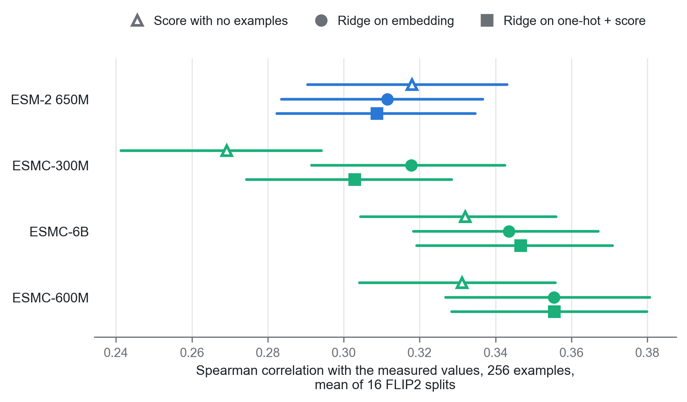

*Each protein language model as a score with no examples, as a ridge on its embedding, and as a ridge on one-hot
features with its score, on the 16 FLIP2 splits.*

*The same ridge on features that hold less and less. A random vector scores zero, an embedding of shuffled residues 0.03,
and an untrained ESMC-300M what one-hot features do (0.145 against 0.149).*

## Claude models through the public API

A separate experiment on all 300 queries of each split, 256 examples, 16 FLIP2 splits.

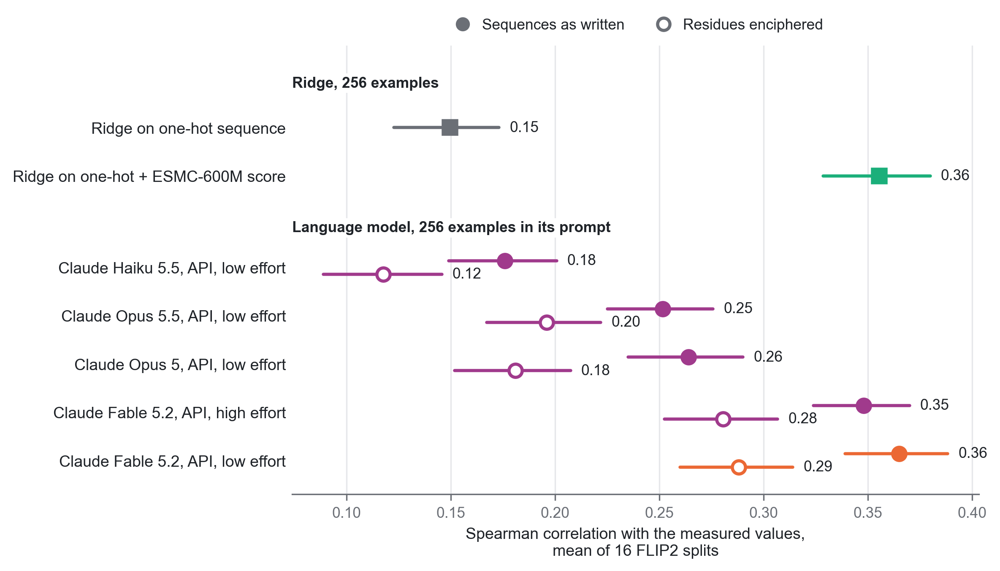

*Each API model with the prompt as written (filled) and with the residues enciphered (hollow), beside two ridges.*

| 16 FLIP2 splits, all queries | Mean Spearman |
|---|---|
| Best ridge on these queries (one-hot + ESMC-600M score) | 0.355 (0.328 to 0.380) |
| Claude Fable 5.2, low effort | 0.365 (0.339 to 0.388) |
| Claude Fable 5.2, high effort | 0.348 (0.324 to 0.370) |
| Claude Opus 5 | 0.264 |
| Claude Opus 5.5, low effort | 0.252 |
| Claude Opus 5.5, high effort | 0.219 |
| Claude Haiku 5.5 | 0.176 |

Claude Fable 5.2 ties the best ridge, +0.009 (-0.015 to +0.036) at low effort, and the three other models are below
it with intervals that exclude zero. Claude Opus 5.5 refused 68 of 265 prompts at low effort and 21 of 53 at high.

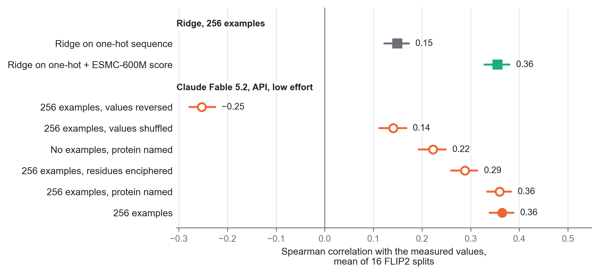

| Claude Fable 5.2, low effort, 16 FLIP2 splits | Mean Spearman |
|---|---|
| 256 examples | 0.365 |
| Protein named | 0.359 |
| Residues enciphered | 0.288 |
| No examples, protein named | 0.222 |
| Shown values shuffled | 0.141 |
| Shown values reversed | -0.253 |

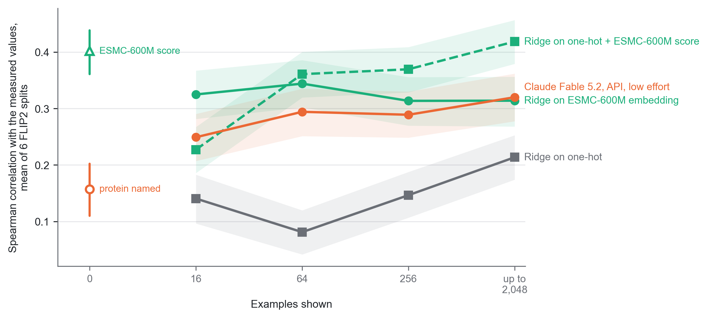

With up to 2,048 examples Claude Fable 5.2 scores 0.386 and the best ridge on the same rows 0.409, a difference of
-0.024 (-0.049 to +0.003). Asked to continue each benchmark protein's sequence, the models get this share of the next
30 residues right on the real sequence and on a shuffled one: Claude Fable 5.2 92% and 7%, Claude Opus 5.5 76% and
8%, Claude Opus 5 70% and 8%, and Claude Haiku 5.5 40% and 7%.

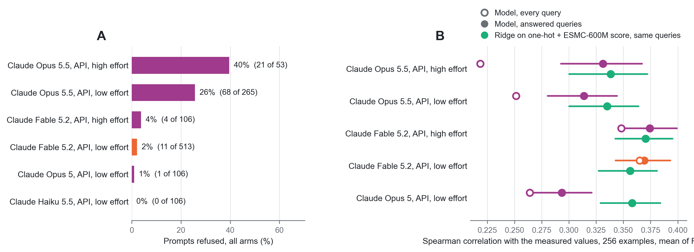
