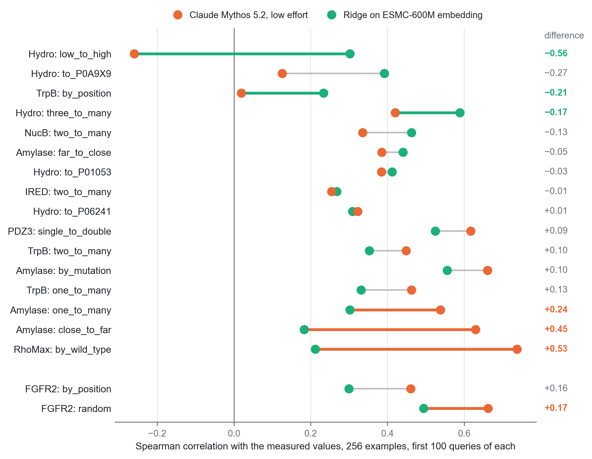
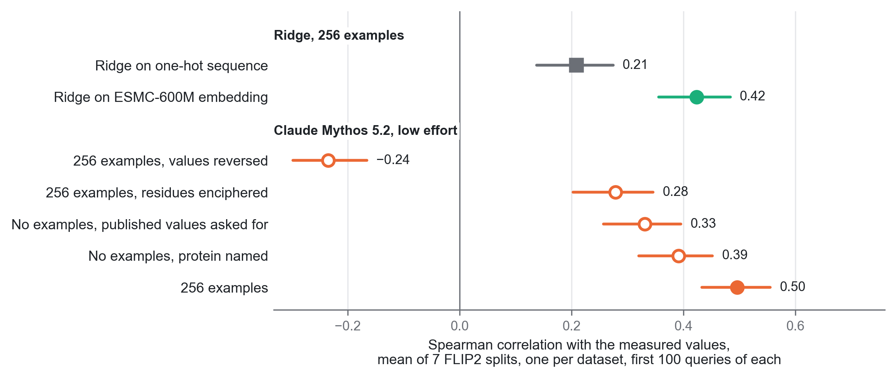
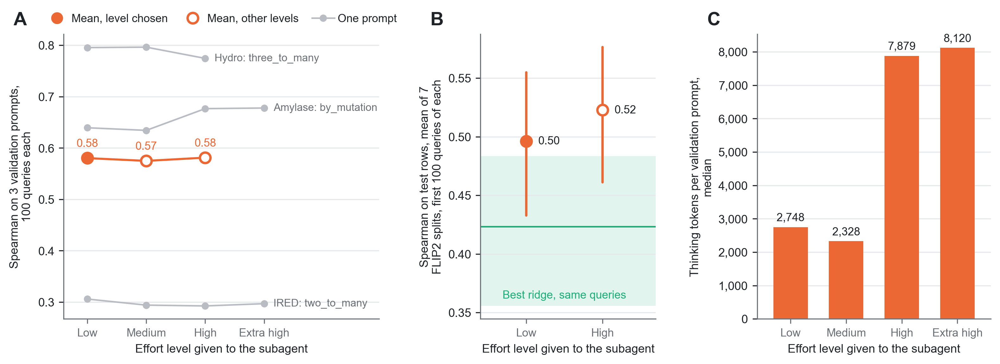
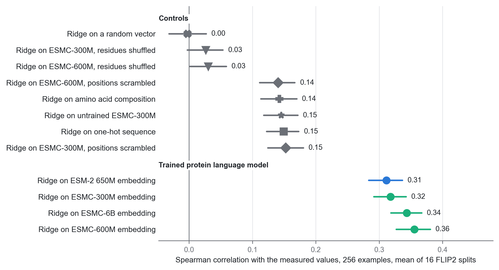

# Results in full

Every table and figure of the two experiments, in the order the [README](README.md) summarizes them. Each number is a
mean Spearman correlation with the measured values unless a table says otherwise, and each interval is a 95% interval
from 2,000 paired bootstrap draws of the queries. The [explainer](docs/index.html) covers the same ground step by step
for a reader outside the field, and [REPRODUCE.md](REPRODUCE.md) holds the commands.

## Every method on FLIP2 and on FGFR2

| 256 examples unless said, first 100 queries of each split | FLIP2, 16 splits | FGFR2, 2 splits |
|---|---|---|
| **Controls** | | |
| Ridge on a random vector | 0.001 (-0.048 to 0.051) | 0.025 (-0.114 to 0.164) |
| Ridge on ESMC-600M, residues shuffled | 0.002 (-0.045 to 0.051) | -0.043 (-0.185 to 0.099) |
| Ridge on ESMC-600M, positions scrambled | 0.113 (0.064 to 0.159) | 0.045 (-0.103 to 0.192) |
| Value of the nearest example | 0.138 (0.092 to 0.183) | 0.221 (0.131 to 0.298) |
| Ridge on untrained ESMC-300M | 0.141 (0.091 to 0.188) | 0.026 (-0.110 to 0.167) |
| Ridge on amino acid composition | 0.141 (0.091 to 0.186) | 0.027 (-0.106 to 0.164) |
| Ridge on one-hot sequence | 0.142 (0.097 to 0.182) | 0.295 (0.175 to 0.410) |
| **ESMC, no examples** | | |
| ESMC-300M score | 0.281 (0.233 to 0.325) | 0.464 (0.330 to 0.577) |
| ESMC-600M score | 0.341 (0.294 to 0.383) | 0.452 (0.328 to 0.564) |
| ESMC-6B score | 0.346 (0.298 to 0.388) | 0.481 (0.355 to 0.601) |
| **ESMC + ridge** | | |
| Ridge on ESMC-300M embedding | 0.288 (0.238 to 0.332) | 0.344 (0.213 to 0.471) |
| Ridge on one-hot + ESMC-300M score | 0.314 (0.264 to 0.354) | 0.555 (0.450 to 0.644) |
| Ridge on ESMC-6B embedding | 0.352 (0.304 to 0.389) | 0.359 (0.222 to 0.481) |
| Ridge on one-hot + ESMC-600M score | 0.364 (0.315 to 0.402) | 0.549 (0.450 to 0.637) |
| Ridge on one-hot + ESMC-6B score | 0.365 (0.315 to 0.404) | 0.572 (0.469 to 0.663) |
| Ridge on ESMC-600M embedding | 0.367 (0.319 to 0.409) | 0.397 (0.255 to 0.514) |
| **General language model** | | |
| Claude Mythos 5.2, 256 examples in its prompt | 0.380 (0.333 to 0.421) | 0.561 (0.458 to 0.646) |

ESM-2 650M on the same queries: 0.335 with no examples, 0.292 as a ridge on its embedding, and 0.312 as a ridge on
one-hot features with its score on FLIP2, and 0.454, 0.377, and 0.559 on FGFR2.

The rule was fixed before any model was asked: in-context learning outperforms if its paired difference from the best
ridge has a 95% interval above zero. The best ridge is chosen on the queries it is scored on, which favors the ridge.

## Two experiments, kept apart

| | Claude Mythos 5.2 | Claude models on the public API |
|---|---|---|
| How it was asked | One fresh subagent of a coding agent per prompt | One Messages API request per prompt |
| Models | Claude Mythos 5.2 | Claude Fable 5.2, Opus 5.5, Opus 5, Haiku 5.5 |
| Queries scored | The first 100 of each split | All 300 of each split |
| Thinking at the level named low | A median of 2,156 tokens a prompt | None |

The two routes differ in the queries, in what surrounds the prompt, and in how much the model thinks, so a gap between
them is not a gap between models. No figure and no table here puts one beside the other. Each is compared only with
baselines scored on its own queries.

## Claude Mythos 5.2

### The tie is an average of large wins and large losses

*Each split, first 100 queries: Claude Mythos 5.2 and the best ridge. A thick line marks a difference whose 95% interval
excludes zero.*

Against the ridge on the ESMC-600M embedding the model is ahead on 3 of 16 splits (`rhomax/by_wild_type` +0.53,
`amylase/close_to_far` +0.45, `amylase/one_to_many` +0.24), behind on 3 (`hydro/low_to_high` -0.56,
`trpb/by_position` -0.21, `hydro/three_to_many` -0.17), and undecided on 10. On `hydro/low_to_high` every test value
lies above the training range, and the model's Spearman is negative.

### It learns from the rows, and it also knows the protein

Each control changes one thing about the prompt. They ran on one split per dataset, the probe splits.

*Mean Spearman over the 7 FLIP2 probe splits, first 100 queries. The filled dot is the plain prompt and each hollow dot
one changed version.*

| 7 FLIP2 probe splits | Mean Spearman | Reading |
|---|---|---|
| 256 examples | 0.496 (0.433 to 0.555) | Ridge on the ESMC-600M embedding scores 0.423 |
| 256 examples, residues enciphered | 0.278 (0.203 to 0.346) | The protein cannot be recognized. Still +0.070 over one-hot ridge (0.209) |
| 256 examples, values reversed | -0.235 (-0.298 to -0.166) | The ranking follows the rows, not what the model believed |
| No examples, protein named | 0.391 (0.320 to 0.452) | The zero-shot score of ESMC-6B is 0.318 |
| 256 examples, high effort | 0.523 (0.461 to 0.576) | +0.027 (-0.012 to +0.068) over low effort |

Reversed values reverse the ranking on six of eight datasets, the post-cutoff one among them. About half of the score
needs the protein to be recognizable, and with no examples the model is level with a protein language model's
zero-shot score.

| Split | No examples | 256 examples | Enciphered | Reversed | Ridge, ESMC-600M embedding | Ridge, one-hot |
|---|---|---|---|---|---|---|
| `amylase/by_mutation` | 0.347 | 0.661 | 0.539 | -0.589 | 0.556 | 0.500 |
| `hydro/three_to_many` | 0.125 | 0.420 | 0.232 | -0.404 | 0.588 | -0.020 |
| `ired/two_to_many` | 0.294 | 0.254 | 0.178 | 0.050 | 0.268 | -0.045 |
| `nucb/two_to_many` | 0.422 | 0.335 | 0.113 | -0.298 | 0.463 | 0.011 |
| `pdz3/single_to_double` | 0.613 | 0.617 | 0.523 | -0.543 | 0.525 | 0.522 |
| `rhomax/by_wild_type` | 0.658 | 0.737 | -0.020 | 0.583 | 0.212 | 0.085 |
| `trpb/two_to_many` | 0.281 | 0.448 | 0.382 | -0.444 | 0.353 | 0.407 |
| `fgfr2/random` (after the cutoff) | 0.378 | 0.662 | 0.342 | -0.493 | 0.494 | 0.462 |

*Each probe split under four versions of the prompt, beside the ridge on the ESMC-600M embedding.*

Rhomax is the exception. The model scores 0.658 there with no examples, 0.583 against reversed rows, and -0.020 under
the cipher, so its largest lead over the ridge comes from prior knowledge of rhodopsins and is not in-context learning.
With Rhomax left out, a check added after the results were seen, the model scores 0.36 and the ridge 0.38 on the 15
other splits, a difference of -0.02 (-0.07 to +0.03).

### Memory of the benchmark

FLIP2's splits were public before the model's training data end, so three probes ask how much is recited.

*Answers equal to the published value, against the count a random deal of the same answers gives.*

Asked for the published values with no examples, the model wrote 0 of 400 exactly on the four probe splits with
continuous values, where a random deal of its own answers gives 0.06.

Rhomax is a separate case, because its values are whole nanometers and 7 to 14 of 100 answers are exact depending on the prompt, against about 1 from a
random deal. This does not separate recall of the table from accurate knowledge of each rhodopsin.

From the parent sequence and 30 unlabeled rows the model named the protein, the measurement, and the source study of
all seven FLIP2 datasets. For FGFR2 it named the kinase domain and gave no source.

The FGFR2 screen (MaveDB `urn:mavedb:00001329-a-3`) was published after the model's training data end, and the tie
holds there.

### Knowing a sequence is not predicting its property

Does the model score well on the proteins it knows best? Pseudo-log-likelihood (PPLL) measures how well a masked
language model knows a sequence: the mean log-probability it gives each residue when that one position is masked.
Claude Mythos 5.2 returns no probabilities, so it was asked to fill in sequences with 15%, 50%, and 85% of the residues
hidden, and the share it gets right stands in for PPLL. The sequences are the 6 dataset parents, 48 Rhomax queries,
and 12 shuffled copies, and the protein language models read the same masks.

*A, B. Masked residues filled in correctly on natural and on shuffled sequences. C. One dot per rhodopsin: the share
Claude Mythos 5.2 fills in against the error of the absorption maximum it predicts with no examples. D. Spearman
across rhodopsins between knowledge of a sequence and absolute error on it, with 95% intervals.*

| Share of masked residues right | 15% masked | 50% masked | 85% masked |
|---|---|---|---|
| Claude Mythos 5.2, 48 rhodopsins | 0.914 | 0.758 | 0.568 |
| Claude Mythos 5.2, 6 parents | 0.880 | 0.562 | 0.095 |
| ESMC-6B, 48 rhodopsins | 0.594 | 0.540 | 0.125 |
| ESMC-600M, 48 rhodopsins | 0.412 | 0.341 | 0.127 |
| Most common visible residue, 48 rhodopsins | 0.110 | 0.112 | 0.102 |
| Claude Mythos 5.2, 12 shuffled copies | 0.107 | 0.101 | 0.096 |

A sequence comes back nearly whole or at the rate of a guess. The model returned 34, 32, and 23 of the 48 rhodopsins
at least 90% right at the three levels, and 19 at all three. It wrote out FGFR2 and TrpB with half the residues
hidden, and amylase and PDZ3 with 15% hidden. No protein language model reached 90% on any rhodopsin. The FGFR2 screen
is new to the model, and the FGFR2 sequence is not.

Across the 48 rhodopsins, the share the model fills in has a Spearman of -0.15 (-0.41 to +0.13) with its absolute
error on the absorption maximum with no examples, and -0.04 (-0.33 to +0.24) with 256 examples. In a check added after
the results were seen, the 8 rhodopsins it wrote out at no level have a median error of 3.5 nm and the 19 it wrote out
at every level 4.0 nm.

Across 100 rhodopsins, PPLL against the error of the ridge on the same model's embedding gives -0.50 (-0.64 to -0.33)
for ESMC-600M, -0.20 (-0.35 to -0.02) for ESM-2 650M, -0.08 (-0.30 to +0.15) for ESMC-300M, and +0.03 (-0.18 to +0.25)
for ESMC-6B. The three ESMC models rank the rhodopsins by PPLL nearly alike (Spearman 0.82 to 0.95), so the relation
belongs to one model's ridge.

Rhomax is the one dataset here in which each query is its own natural sequence, so it is the only place the question
can be asked per sequence. Forty-eight sequences detect a correlation of about 0.4 or more, each prompt was asked
once, and the rhodopsins include variants of shared wild types. This test does not separate knowledge of the family
from memory of measured values. The tables are in `report/tables/sequence_knowledge/`.

### Use both

The average of the model's ranking and the best ridge's scores 0.443 (0.399 to 0.482) on FLIP2, +0.063 over the model
and +0.077 over the ridge, with both intervals above zero. On FGFR2 it reaches 0.611. The average uses equal weights
and no tuning.

### Effort

Low effort was chosen on validation rows (0.580 at low, 0.575 at medium, 0.581 at high). On test rows high effort minus
low is +0.027 (-0.012 to +0.068), and the gain is on two datasets.

## The baselines alone

On all 300 queries of each split, with no language model in the figure.

*Each protein language model as a score with no examples, as a ridge on its embedding, and as a ridge on one-hot
features with its score, on the 16 FLIP2 splits.*

*The same ridge on features that hold less and less. A random vector scores zero, an embedding of shuffled residues 0.03,
and an untrained ESMC-300M what one-hot features do (0.145 against 0.149).*

## Claude models through the public API

A separate experiment on all 300 queries of each split, 256 examples, 16 FLIP2 splits.

*Each API model with the prompt as written (filled) and with the residues enciphered (hollow), beside two ridges.*

| 16 FLIP2 splits, all queries | Mean Spearman |
|---|---|
| Best ridge on these queries (one-hot + ESMC-600M score) | 0.355 (0.328 to 0.380) |
| Claude Fable 5.2, low effort | 0.365 (0.339 to 0.388) |
| Claude Fable 5.2, high effort | 0.348 (0.324 to 0.370) |
| Claude Opus 5 | 0.264 |
| Claude Opus 5.5, low effort | 0.252 |
| Claude Opus 5.5, high effort | 0.219 |
| Claude Haiku 5.5 | 0.176 |

Claude Fable 5.2 ties the best ridge, +0.009 (-0.015 to +0.036) at low effort, and the three other models are below
it with intervals that exclude zero. Claude Opus 5.5 refused 68 of 265 prompts at low effort and 21 of 53 at high.

| Claude Fable 5.2, low effort, 16 FLIP2 splits | Mean Spearman |
|---|---|
| 256 examples | 0.365 |
| Protein named | 0.359 |
| Residues enciphered | 0.288 |
| No examples, protein named | 0.222 |
| Shown values shuffled | 0.141 |
| Shown values reversed | -0.253 |

With up to 2,048 examples Claude Fable 5.2 scores 0.386 and the best ridge on the same rows 0.409, a difference of
-0.024 (-0.049 to +0.003). Asked to continue each benchmark protein's sequence, the models get this share of the next
30 residues right on the real sequence and on a shuffled one: Claude Fable 5.2 92% and 7%, Claude Opus 5.5 76% and
8%, Claude Opus 5 70% and 8%, and Claude Haiku 5.5 40% and 7%.

